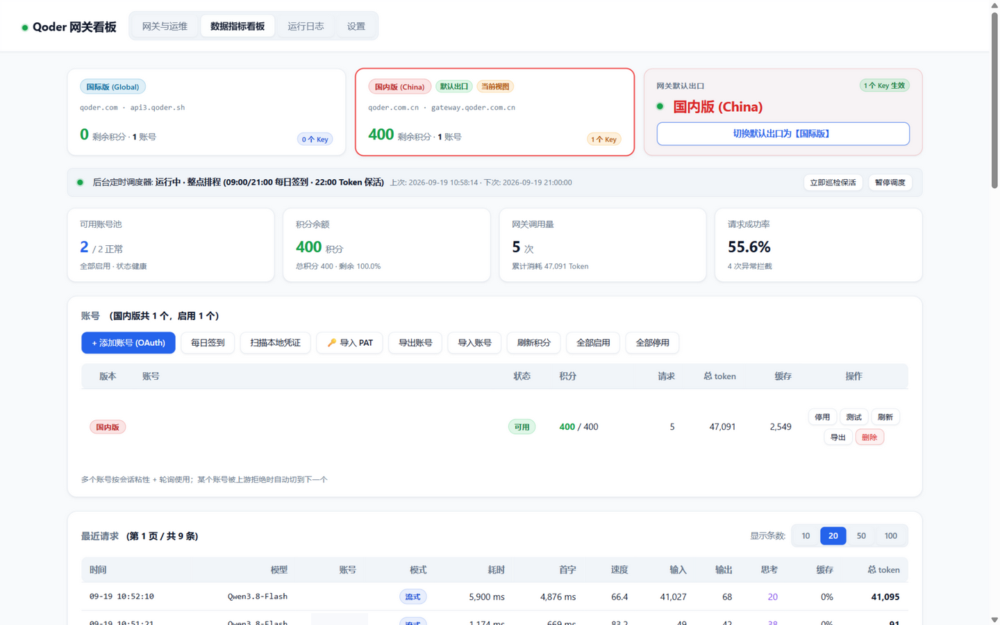
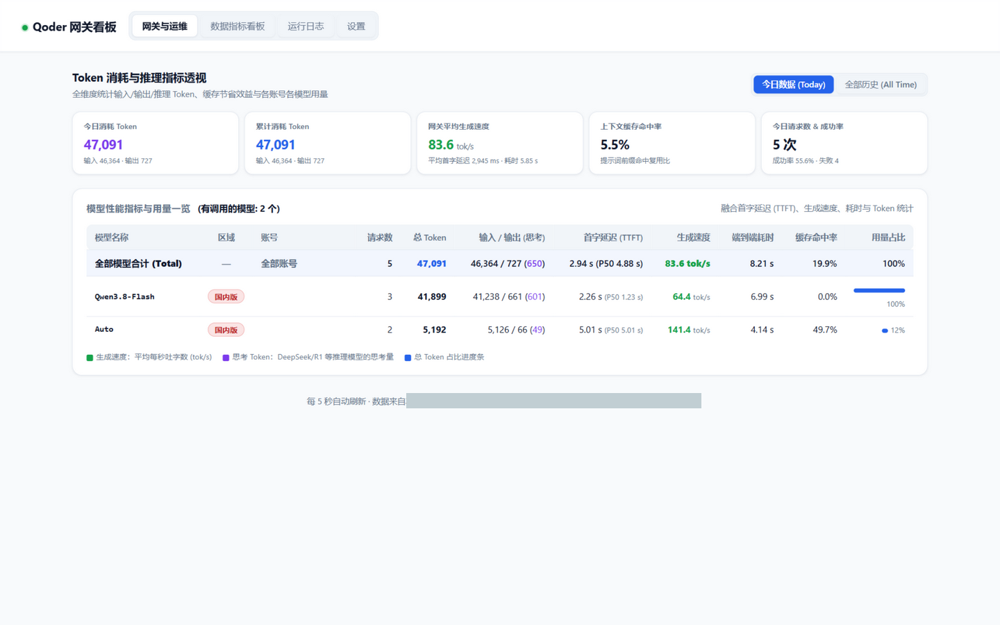

# Qoder2API-Hub — 国际版、国内版多账号网关中枢

<p align="center">
  
  
  
  
  
  
</p>

本项目为 **Qoder2API-Hub**，将阿里 **[qoder.com.cn](https://qoder.com.cn)** (国内版) 与 **[qoder.com](https://qoder.com)** (国际版) 的原生服务封装为标准 OpenAI 兼容接口，支持 Chat Completions 与 Responses API。具备多账号负载轮询、稳定物理设备指纹隔离、OAuth 设备授权一键免客户端登录、每日签到与实时额度查询、Pro 福利包自动领取、后台常驻定时调度器、Web 监控看板等全套能力 —— 与 WorkBuddy2API-Hub 同构的完整功能矩阵。

- **开箱即用**：双击批处理脚本（Windows）或运行 `./start-qoder-proxy.sh`（Linux / macOS）即启；亦支持 Docker 容器化部署，零外部 pip 依赖。
- **本机已登录凭证一键入池（双区）**：只读探测桌面 App（`auth.v1.dat`，os_crypt/DPAPI 解密）与 Qoder CLI（`~/.qoder*/.auth/user`，AES-128-CBC）两类官方存储，看板两步确认导入，永不静默采用。
- **模型清单完全跟官方走（双区不同、以官方此刻为准）**：三源优先级 —— 动态 `/algo/api/v2/model/list`（COSY 签名，**GET 需携带与签名一致的 `{}` body，否则 403**）> 本机官方客户端模型目录缓存（`~/.qoder*/.models/<uid>/catalog-v6`，QMC/HKDF+AES-256-GCM 解密）> 双区官方快照文件（`qoder_catalog_intl.json`/`qoder_catalog_cn.json`，`python _refresh_catalog.py` 一键随客户端更新）；清单**以动态源返回的集合为准**（官方桌面版此刻显示什么这里就显示什么，如国际版动态 15 条就不多塞静态独有的 `smodel/cmodel`）。**逐字段忠实保留**：`id` = **官方模型名**（如 `Qwen3.8-Max`，客户端唯一需要填的值；`upstream_key`/`aliases` 同时给出 key、`key (Name)` 与人类别名等全部可填形式）、官方桌面版介绍文案（`description`，取自客户端 dynamic-text）、本地化名（`name_local`，如 Ultimate→极致）、`context_config` 多窗口（200K 默认/400K/1M）、`thinking_config` 思考档位（low/medium/high/xhigh/max + 默认标注 + 可关闭）、**峰谷价**（`price_factor_peak` 促销前倍率 → `price_factor_valley` 谷时倍率 + `off_peak` 时段窗口 22:00-08:00 与官方错峰文案）、`is_free/is_new`；官方 `enable=false` 条目不过滤，附**官方原文禁用原因**（`disabled_reason = "需要升级或购买千问官方套餐开放"`，并透传上游 `disabled_message_key`）。**最大输出**：官方 catalog 与动态接口原始响应均无此字段，故不再输出/展示任何编造值。
- **双区域独立路由**：支持 🌐 国际版 (qoder.com / api1.qoder.sh，备用 api2/api3 自动故障切换) 与 🇨🇳 国内版 (qoder.com.cn / gateway.qoder.com.cn) 独立配置与管理，区域独占模型（如国内 `q37fmodel`/`glm-5.2`、国际 `smodel`/`ultimate`）自动路由到归属出口并拦截错配 Key，看板一键切换且状态落盘持久化。
- **COSY 签名推理链路**：RSA 包裹 AES 会话密钥 + MD5 请求签名 + 自定义 Base64 请求体编码，纯标准库实现（含 AES-128/256、RSA-PKCS1v15、GCM、DPAPI、QMC 纯 Python 实现，Docker alpine 下同样零依赖），逆向对齐官方桌面/CLI 客户端协议。
- **稳定物理设备指纹隔离 (`derive_id`)**：以账号自身 UID 稳定哈希派生专属 `cosy-machineid` / `cosy-machinetoken` / 会话标识，同一账号长期固定在同一台虚拟物理设备，天然防多号关联风控。
- **OAuth 设备授权一键免客户端登录**：PKCE (S256) 设备流（双区 URL 参数按官方差异构造：国内带 `redirect_uri+client_id+machine_id`，国际带 `client_id+machine_id`），点击看板链接在浏览器完成授权即可自动入池；亦支持 PAT (`pt-`) 导入，jobToken 自动交换与轮换。
- **每日签到与额度体系（双区域 · 真实领取）**：「每日领取 100 Credits」等活动**由网关直接领取**——用桌面端请求头（`Cosy-ClientType: 10` + 机器头，缺了服务端会返回空列表）列出活动 → 对 `CLAIMABLE` 的 Credits 活动 `POST /sash/api/v1/me/campaigns/{id}/claim`（官方幂等：已领返回 `replayed`，不会重复发放）；旧 sash 签到接口仅在仍开放时兜底（能力运行时探测，404 记「本区域无此接口」6 小时后自动重探）；Pro 升级包资格检查与领取、quota/usage 额度与套餐快照实时刷新。
- **后台常驻定时调度器**：每日整点排程（09:00 / 21:00 签到 · 22:00 Token 集中保活），`drt-` / `jrt-` 按前缀路由刷新，PAT 最终兜底。
- **双协议全功能支持**：同时支持标准 OpenAI Chat Completions 协议与 Responses API (Codex / Claude Code)，含 custom freeform 工具（`apply_patch`）双向转译、DSML 工具调用回退解析，以及**泄漏文本回读**（模型把历史工具调用序列化复述成正文时，流式/非流式/Responses 三链路都还原为结构化 `tool_calls`；若回声被**截断**无法还原，则按严格判据吞掉、绝不把内部标记透给用户，而普通回复一律 fail-open 不吞正文）。
- **现代化 Web 看板**：弹性指标卡片、签到与福利中心、模型能力清单、性能指标与用量透视、实时请求流水与运行日志。

> ⚡ 本项目架构与交互对齐 WorkBuddy2API-Hub，上游协议替换为 Qoder COSY 签名体系。

---

## 🖼️ 看板预览 (Dashboard Preview)

**网关总览** —— 双区出口状态、调度器、账号池与请求流水一屏尽览：



**模型清单** —— 与官方桌面版同源：官方模型名、峰谷价、上下文多窗口、思考档位、能力徽标：


**数据指标看板** —— Token 消耗透视、TTFT 首字延迟、生成速度与缓存命中率：



**签到与福利中心** —— 每日签到领积分、Pro 福利包一键领取、限时活动真实状态（双区域）：


---

## 一、快速启动

### 1. 本机单机使用
双击运行 **`start-qoder-proxy.bat`**（Windows）或 `./start-qoder-proxy.sh`（Linux / macOS），保持窗口运行：
- **API 接口地址**：`http://127.0.0.1:8790/v1`
- **Web 监控看板**：`http://127.0.0.1:8790/`

> ⚠️ **"客户端一直显示工作中、一个字都不吐，网关日志也毫无变化"** → 九成是**网关没在跑**：请求根本没到达，所以日志自然一动不动。一条命令确诊：
> ```bash
> python _diag_gateway.py --chat   # 端口 → /health → /v1/models → 真实流式，逐项报出断在哪
> python _diag_campaign.py         # 签到/活动链路体检（含本机虚拟化状态，中文输出）
> ```
> - **生命周期就是那个窗口**（刻意的设计）：窗口开着网关就活着，**关掉窗口（或 Ctrl+C）网关即停**，不会有后台残留进程；下次要用重新运行启动脚本即可。
> - 判别口诀：日志时间戳停在某一刻、此后再无 `POST /v1/chat/completions` = 网关已停；重新运行启动脚本即可恢复。

> ℹ️ 默认端口 **8790**（8788 被 `mimo-api-proxy.mjs` 占用，8789 为 wb-proxy 默认）。改端口：`start-qoder-proxy.bat 8791` / `./start-qoder-proxy.sh 8791`。

> 🐧 **Linux / macOS**：三个启动脚本与 `.bat` 一一对应 —— `start-qoder-proxy.sh`（本机）、`start-qoder-proxy-lan.sh`（局域网）、`allow-firewall.sh`（放行防火墙，需 `sudo`）。首次使用先 `chmod +x *.sh`。脚本自动探测 `python3` / 便携运行时（要求 Python 3.9+），退出码透传；`allow-firewall.sh` 会自动识别 ufw / firewalld / nftables / iptables，WSL2 下还会打印 Windows 侧所需的防火墙与 `netsh portproxy` 步骤。

首次启动若无账号，直接打开看板点击 **「+ 添加账号 (OAuth)」**，在浏览器完成设备授权即可自动加入；或点 **「🔑 导入 PAT」** 粘贴个人访问令牌。

### 2. 面板访问密码

打开看板需要先输入**面板访问密码**，默认是 `admin`。它与 API Key 相互独立：

- 面板密码只用于打开网页看板，可在看板「设置」页修改（也可启动时 `--panel-password` 指定）；
- 密码以 PBKDF2-SHA256 摘要形式保存在 `accounts/settings.json`，不存明文；
- 登录状态存放在浏览器会话中，关闭浏览器或重启网关后需要重新输入。

> 首次登录后请立即到「设置」修改默认密码。

### 3. 局域网共享模式
运行 **`start-qoder-proxy-lan.bat`**（Windows）或 `./start-qoder-proxy-lan.sh`（Linux / macOS），允许局域网内其他设备访问：
- **Base URL**：`http://<本机局域网IP>:8790/v1`
- **密钥随机生成并持久化**：LAN 模式首次启动生成高强度随机 API Key（`qd-` 前缀），保存到 `accounts/settings.json` 并在终端打印，重启复用。
- **自定义 Key**：`start-qoder-proxy-lan.bat 8790 我的Key` / `./start-qoder-proxy-lan.sh 8790 我的Key`
- 支持带密钥直达面板：`http://<IP>:8790/?key=生成的Key`。
- 其他设备连不上时放行防火墙：Windows 管理员运行一次 `allow-firewall.bat`；Linux 运行 `sudo ./allow-firewall.sh`（自动识别 ufw / firewalld / nftables / iptables；WSL2 另需 Windows 侧规则与 `netsh portproxy`，脚本会打印具体命令）。

### 4. 多 API Key 管理与出口绑定

网关支持**多 API Key 并行管理**，并可为每个 Key 指定独立出口：

- **添加与在线生成**：看板「设置」页，输入名称 + 一键生成随机 Key；
- **出口自由绑定**：
  - 🌐 **国际版出口**：该 Key 流量强制走 `api1.qoder.sh`（连不上自动切 api2/api3）
  - 🇨🇳 **国内版出口**：该 Key 流量强制走 `gateway.qoder.com.cn`
  - **跟随面板切换**：未绑定出口的 Key 实时跟随看板顶部全局出口
- **状态管理**：单独启停、一键删除，删除即刻失效；配置持久化到 `accounts/settings.json`；
- **安全防冲突**：面板配置过 Key 后，启动脚本里的旧 `--api-key` 自动失效；
- **模型区域自检**：Key 出口与模型区域不匹配时返回通俗 400，杜绝上游晦涩拒流报错。

### 5. Docker 容器化部署

**方式一：官方预构建镜像（推荐）**。每个版本会自动构建并推送多架构（amd64 / arm64）镜像到 GHCR，升级只要 `pull`：

```bash
# 1. 拉取并启动
docker compose pull
docker compose up -d

# 2. 查看网关日志
docker compose logs -f
```

**方式二：从源码自行构建**。把 `docker-compose.yml` 里的 `image:` 注释掉、改用 `build: .`：

```bash
docker compose up -d --build
```

或直接 `docker run`：

```bash
docker run -d --name qoder-proxy --restart unless-stopped \
  -p 8790:8790 -v $(pwd)/accounts:/app/accounts -v $(pwd)/usage:/app/usage \
  -e API_KEY=your_secret_key ghcr.io/shuishuipingan/qoder2api-hub:latest
```

> **镜像与版本入口**：[**GHCR 包页面**](https://github.com/shuishuipingan/qoder2api-hub/pkgs/container/qoder2api-hub)（列出全部可用 tag、架构与拉取命令）· [**Releases**](https://github.com/shuishuipingan/qoder2api-hub/releases)（每个版本的变更说明）。
>
> 可用 tag：**`latest`** · **`1.3`**（跟随最新 1.3.x）· **具体版本**（如 `1.3.3`）· **`sha-<短提交>`**（钉死某次构建）。镜像为 **linux/amd64 + linux/arm64** 双架构。
>
> 提示：GitHub 仓库**首页侧栏**未必列出容器包 —— 用上面那个包页面链接即可，或直接 `docker pull ghcr.io/shuishuipingan/qoder2api-hub:latest`。

```

- **持久化目录**：`./accounts`（账号凭证及出口设置）与 `./usage`（请求流水与指标快照）；
- **配置参数**：环境变量 `API_KEY`、`PORT`（监听端口，默认 8790）、`HOST`（监听地址，默认 127.0.0.1；容器内如需对外暴露设为 0.0.0.0）。

> **设备身份稳定性（issue #18 实测 + v1.2.13 起根治）**：容器里的机器身份是**「容器级」**的——默认 `bridge` 网络下**重启即换**（含 `docker compose restart` 与宿主机重启后自动拉起），任何网络模式下**重建即换**。若你依赖「每台设备每日限领」这类按设备去重的规则，**只要 `accounts/` 是挂载卷，v1.2.13 起默认就已根治**（见下 ①）。注意：**推理 / API 链路不受影响**，它用的是按账号 UID 派生的身份。
>
> **① 机器身份落盘缓存（v1.2.13 起默认启用 —— 根治「重建 / 升级必换」）**
> 网关会把官方组件**首次输出的**身份缓存到 `accounts/machine_identity.json`，之后**优先复用**：重建、升级、重启容器后设备身份**保持不变**。
>
> - **前提**：`accounts/` **必须是挂载卷**（不挂卷时缓存写在容器内部、随容器消亡，等于没缓存）；
> - 缓存的是**官方组件自己的输出**，不是伪造；
> - ⚠️ **更正（v1.2.16，据 issue #18 的实测）**：组件**会**落状态文件 —— 它在 `$HOME/.config/.locale_cfg`（350 B）里存一个**随机种子**，身份由「该种子 + 机器证据 + 容器证据」共同决定。**「想换身份」本质上就是换这个种子**（我们之前「组件不落状态文件」的说法是错的）；
> - **机制（三输入模型）**：`identity = f(种子[, $HOME/.config/.locale_cfg], 机器证据[DMI / CPU / …], 容器证据[/proc/mounts 的 overlay 行、网卡 MAC])` —— 这解释了两件事：**同一容器内身份恒定**（种子不变，实测 69 分钟 24 次采样无变化），而**重建容器会换**（overlay 行变，compose 层盖不住）；
> - **想主动换身份**：删除 `accounts/machine_identity.json`（或启动时设 `QD_MACHINE_IDENTITY_RESET=1` 跑一次）；
> - **不想启用**：`QD_MACHINE_IDENTITY_CACHE=off`（回到旧行为）；
> - **想定期轮换**：`QD_MACHINE_IDENTITY_CACHE_TTL=<秒>`（默认 `0`＝不过期）。到期后会**清掉组件种子并取一个新身份**（**真的换**，不是重读一遍同一个值），重建后身份也随之改变；
> - **三条会自动「换身份」的路径**：① 服务端不认当前身份时的**自愈**（`campaigns()` 判 `showCampaign=false`）；② **`QD_MACHINE_IDENTITY_RESET=1`**（或直接删缓存文件）；③ **TTL 到期**。**其余路径一律不碰种子** —— 否则「重建不换」会被自己削弱；
> - 若服务端某天不再接受该身份，既有**自愈**会在活动列表被判「未认可」时刷新并**更新缓存**（日志有 WARN 提示）；
> - ⚠️ 该文件代表**物理机器的身份**，**不要跨机器共享 `accounts/`**；顺带一提，组件不可用时（如 alpine 缺兼容层）现在也能**继续用真身份**，而不是退化成派生假身份。
>
> **② 固定网卡 MAC（可选）** —— 如果你**不想**启用落盘缓存、或希望组件调用本身也稳定：
>
> **① 固定网卡 MAC（推荐，代价最小）** —— 留在默认 bridge 网络、**保留 `ports:` 映射**：
> ```yaml
> services:
>   qoder-proxy:
>     mac_address: "02:42:ac:11:00:77"
>     ports: ["8790:8790"]
> ```
>
> 📌 **v1.2.13 起本方案已非必需**：只要 `accounts/` 是挂载卷，落盘缓存就连「重建/升级」都覆盖了（见上面 ①）。保留这一条是给「不挂载 `accounts/`」或「希望组件调用本身也稳定」的场景。
> ⚠️ 上面那串 MAC **只是示例，请换成你自己生成的**，别照抄——macvlan 网络或同一宿主机跑多个实例时会撞 MAC：
> ```bash
> printf '02:42:%02x:%02x:%02x:%02x\n' $((RANDOM%256)) $((RANDOM%256)) $((RANDOM%256)) $((RANDOM%256))
> ```
> 若你的 Docker 拒绝 service 级 `mac_address`（官方文档提到 Engine ≥ v25 可能拒绝；实测 Docker 29.6.1 与 29.7.2 均接受），改用 `networks.<网络名>.mac_address`。
>
> **② `network_mode: host`（备选）** —— 彻底共享宿主网络栈，适合宿主机端口冲突、或确实需要容器直接占用宿主端口时；代价是不能用 `ports:` 映射，且**切换前请确认目标端口在宿主机上空闲**，否则容器会启动失败。
>
> **机制（两输入模型）**：`identity = f(每容器独有的量, 容器网卡 MAC)` —— bridge 下容器停止会重建 veth、MAC 随之改变，而身份同时依赖这两者；固定 MAC 即可让 `stop/start` 后身份逐字节不变。**两条路都只解决「重启」这一类**：**重建容器仍会换**（由「每容器独有的量」决定，compose 层无法覆盖）。
>
> 以上已在 **amd64 与 arm64**、真实官方镜像 + 真实 compose 下验证（issue #18 的作者与我们的独立复现）。

---

## 二、核心特性详解

### 1. 请求链路（COSY 签名推理）

**瞬时故障韧性（双层）**：上游把自己的 provider 故障包装成 `418/5xx + provider_error` 抛回，或对 `qoder.sh` 出现 TLS/连接抖动（`SSL: UNEXPECTED_EOF...`）时：
- **连接层**（urlopen 时刻的 HTTP/传输错误）：同账号快速重试 2 次（1s/2s 退避）；
- **流内信封层**（关键形态：上游先 HTTP200 建流、再在 SSE 信封里投 `statusCodeValue=418`——表现为 access log 记 200 而业务错 418）：在**尚未向客户端写出任何上游字节**前重开上游重试 2 次（chat 流式/非流式 + Responses 全覆盖），流式客户端全程无感。

重试仍失败才**短冷却（15s，单账号池实际 3s）换号**——不因上游的锅罚账号 60 秒；**短错误冷却期间（≤10s）后续请求改为「等待续上」而非报错**，且 `429 usage exceeds frequency limit` **只在上游真频控时出现**（账号错误冷却不再被误标为频控）。客户端参数错误（`invalid_parameter_error` 等）与**上游内容安全审核拒绝**（`InternalError.Algo.DataInspectionFailed: Input text data may contain inappropriate content`）**绝不重试**、快速失败——后者返回中文解释（`content_policy_rejected`：确定性拒绝、重试无效，请检查/缩短输入），由调用方修改输入而非等待。耗尽后其余瞬时错误客户端收到中文友好提示（`upstream_transient_error`）；错误详情经 `qoder_detail` 挂载保留 400 字节完整送达日志（含内层 `details`）。

**HTTP 帧层与保活（治“一直重连/连不上”）**：

- **流式响应使用 HTTP/1.1 `Transfer-Encoding: chunked`** 并以 `0\r\n\r\n` 正确收尾，**不再发 `Connection: close`**：同一个 keep-alive 连接可连续复用（实测同连接连发 5 次流式全部成功）。此前裸写字节 + `close` 会让连接池型客户端复用已半关闭的连接，表现为反复重连。
- **SSE 心跳保活**：上游首字延迟实测可达 **40–71 秒**（`xhigh` + 2–3 万 token 长上下文），等待期间网关每 5 秒发送一个 SSE 注释帧 `: ping`（客户端规范要求忽略），避免客户端/中间代理空闲超时断连重连。可用环境变量 `QD_SSE_HEARTBEAT` 调整间隔（秒，`0` 关闭）。
- **探活端点**：`GET /ping`（以及 `/healthz`、`/livez`、`/readyz`）返回纯文本 `pong`，**不需要面板密码或 API Key、不查账号池**——供客户端/脚本判活用；此前返回 404 会被判成网关不可用而反复重连。完整状态仍看 `GET /health`。

- **出口代理（零代码）**：网关用标准库发请求，代理由**环境变量**决定——HTTPS_PROXY / HTTP_PROXY / ALL_PROXY（任一设置即生效），**没设则直连**（不继承 Windows 系统注册表代理，原因见下条）；**需要换出口（例如国际版走代理）时，设置环境变量就行，不必改配置**；容器里用 -e HTTPS_PROXY=... 传入。
  - **Windows 系统代理与「首次请求固化」（#27 修复）**：Python 的 urllib 在 Windows 上会**连带读 WinINET 注册表**里的系统代理（不只是环境变量），且默认 opener 会在**进程首次请求时把当时的代理配置固化**——如果网关启动时你的代理工具开着（如 Clash，127.0.0.1:7897）、之后又关掉它，长驻进程会一直去连那个已无人监听的端口（WinError 10061），token 刷新与全部模型调用全挂，直到重启网关。**本仓现行策略**：出站统一走自建 opener（_opener_for_request），**代理只看环境变量、忽略注册表，且每请求现读**（无固化——开关代理对下一次请求立即生效）。
  - **受影响的人怎么办**：如果你平时**靠系统代理才能上网**（且从没设过代理环境变量）——升级后需要显式设置一次：Windows 执行 setx HTTPS_PROXY http://127.0.0.1:7897（端口换成你自己的代理工具），然后重启网关；只想本地直连的**无需任何操作**。**TUN / fake-ip 型代理**（Clash 等）在网络层透明转发，**无需任何设置**、行为不变。
  - 若你用的是 **fake-ip 模式的透明代理**（Clash 等），网关已内置 `_FAKEIP_NETS` 把 fake-ip 网段视为有效，**不会**因为 DNS 把域名解析成内网地址而拒绝请求。
  - 说明：我们**没有**做「按账号绑定不同出口」那套（每账号独立代理槽 + 出口情报）—— 因为账号都由你本机导入、出口天然相同，实测也没有「上游按 IP 风控」的信号。**将来若真撞上按 IP 风控**，最小方案是给账号加一个可选 `proxy` 字段并让出站走 `ProxyHandler`（约 25 行）。

- **积分汇总（只读，给下游轮询用）**：`GET /credits/summary` —— 走 **API-key 级鉴权**（`_key_ok`：API Key 或面板会话均可，未设 Key 时放行），**只返回本地已登记的 `credits`，绝不触发任何上游查询**（对照 `GET /accounts/credits`：那个会**逐号强制刷新**，适合作者手动点、不适合机器轮询）。
  - 返回：`{ by_realm: {cn, intl}, totals: {remain, accounts}, accounts: [{uid, nickname, realm, credits_remain, credits_used, credits_size, registered_at}], note }`；
  - **新鲜度**：数据来自签到链路写入的权威值与每次消耗的回写，所以它反映的是「**上次登记时的值**」，不是实时余额（字段名与 `note` 字段都在明示这一点）；
  - 未登记过积分的账号（新号还没跑过）会**照常列出**，但 `credits_*` 与 `registered_at` 为 `null`、且不计入汇总；空池 / 无账号时返回空结构而非报错。

**DeepSeek-Flash 偶发失败修复（issue #2）**：这族模型的多轮一致性与 `reasoning_content` 绑定，而旧实现有两处断点，导致"偶发失败、重试有时能过"：

- **判定看的是客户端名字而不是上游模型**：旧逻辑只认名字前缀 `deepseek`，客户端按文档写「内部 key：`dfmodel`」时**整套兼容处理不会执行**。现按上游 key 判定（`is_deepseek_model`：`dmodel`/`dfmodel`/`DeepSeek-Flash`/展示 id「`dfmodel (DeepSeek-Flash)`」都命中）；
- **补好的字段在真实请求路径上被丢掉**：`backfill_reasoning_content()` 写入 `reasoning_content` 后，`flatten_messages()` 压平会话时无条件丢弃该字段——即"兼容层写了但从没发出去"。现按目标模型保留（DeepSeek 族保留、其它模型不带，避免上游因未知字段拒答）。

修复后已对国内版 `dfmodel` 实测：纯问答、展示名 `DeepSeek-Flash`、带 `reasoning_content` 的多轮历史、空 `reasoning_content`、`reasoning` 别名、工具调用历史、流式 27 帧全部 200 正常收尾。

**客户端版本对齐（0.4.3 双区桌面端）**：协议常量按官方客户端当前版本逐项核对——

- `cosy-version` = **1.1.64**（更新自旧 CLI 的 `0.1.43`；取自 0.4.3 内置 `qoder-agent-sdk`/`qoder-cn-agent-sdk` 的版本常量，实测模型列表与推理均正常）；
- 国际版推理主机 = **`api1.qoder.sh`**（客户端 endpoint 缓存里的主选；`api2`/`api3` 为官方故障切换域名，网关同样按序切换，单个域名故障不再拖垮全部请求）；
- 国内版主机 `gateway.qoder.com.cn`、双区 `openapi` 基址、`/algo/api/v2/service/pro/sse/agent_chat_generation`（推理）、`/algo/api/v2/model/list`（模型清单）、`/api/v1/deviceToken|jobToken/*`、`/api/v1/userinfo`、`/api/v2/quota/usage`、`/api/v2/user/plan`、`/sash/api/v1/me/*`（签到/活动平台）**均与新客户端一致**，无变化；
- COSY RSA 公钥与新客户端内置 PEM **逐字节相同**；官方模型目录快照已用新版客户端缓存刷新（价格倍率/上下文/思考默认档等）。

**思考档位（`reasoning_effort`）归一化**：官方上游字段就是 `parameters.reasoning_effort`（0.4.3 SDK 参数表里的 `reasoning_effort`，取值 `none`/`low`/`medium`/`high`/`xhigh`/`max`），但**每个模型的合法档位不同**，而**上游对不支持的档位不报错、直接忽略（回落到模型默认档）**——这就是"给 Qwen3.8-Flash 传档位没反应"的原因：

| 模型 | 官方支持档位 | 默认 | 传 `medium`/`high` 会怎样 |
|---|---|---|---|
| `qfmodel`（Qwen3.8-Flash） | `low` / `medium` / `xhigh` | `medium` | `medium` 生效；`high` 不在表内 → 被忽略 |
| `qmodel_38max`（Qwen3.8-Max） | `low` / `medium` / `xhigh` | `medium` | 同上 |
| `dfmodel`（DeepSeek-Flash） | `low` / `high` / `max` | `max` | `medium`/`xhigh` 都不在表内 → 被忽略（实测输出与默认档一致） |
| `qmodel`（Qwen3.7-Plus） | 无档位（仅开/关） | — | 任何档位都被忽略（只有 `none` 能关掉思考） |

网关现在按**官方目录里该模型的档位表**归一化（`normalize_reasoning_effort()`）：命中原样透传；未命中取"最近的合法档位"（同距时偏向该模型默认档，如 `dfmodel` 的 `medium→high`、`xhigh→max`，`qfmodel` 的 `high→medium`、`max→xhigh`），并在日志标注；模型**有 thinking_config 但无档位表**时不再下发无效档位（只保留 `none`）；模型**完全没有 thinking_config**（如路由器 `auto`）则原样透传，不做猜测。`/v1/models` 的 `reasoning_efforts` / `reasoning_default_effort` 字段即为该模型的合法档位与默认档。另兼容 `reasoning.effort` 与 `thinking.effort/level` 三种客户端写法。

```
客户端 OpenAI 请求
  → build_qoder_body()   官方 baseprompt 模板 + 会话压平（system/工具/参数覆写）
  → qoder_encode()       Qoder 自定义 Base64（标准 B64 三段轮转 + 字母表映射, '=' → '$'）
  → COSY 签名            RSA(1024) 包裹 AES-128 会话密钥 → info(AES-CBC 身份)
                         Bearer = COSY.{payloadB64}.{md5(payload\ncosyKey\ndate\nbody\npath)}
  → POST {gateway}/algo/api/v2/service/pro/sse/agent_chat_generation?…&Encode=1
  → SSE 信封解包          {"headers","body","statusCodeValue"} 嵌套帧 → 内层 OpenAI chunk
  → 标准 OpenAI SSE / chat.completion 回给客户端
```

模型清单按**三源优先级**完全对齐官方（详见「核心特性 · 模型清单」）：

```
1) 动态接口  GET {gateway}/algo/api/v2/model/list?Encode=1   （COSY 签名，需账号，300s 缓存）
2) 本机官方客户端目录 ~/.qoder*/.models/<uid>/catalog-v6      （QMC 解密，离线可用）
3) 内置双区官方快照 qoder_catalog_intl.json / qoder_catalog_cn.json
   （客户端更新后 `python _refresh_catalog.py` 一条命令重新导出并打印差异；
    两个文件缺失时才回退 qoder_catalog.py 内嵌的冻结副本并打印 WARNING）
```

**双区清单不同**（源自本机官方客户端 catalog 的**全字段**忠实快照，chat 场景；`id` = 官方模型名，直接照抄即可）：

- 🇨🇳 **国内版 (动态 14 条，全部开通)**：`Auto` · `Qwen3.8-Max` · `Qwen3.8-Flash` · `Qwen3.7-Max` · `Qwen3.7-Plus` · `Qwen3.7-Flash` · `DeepSeek-V4-Pro` (96K) · `DeepSeek-Flash` · `GLM-5.3` · `GLM-5.3-Flash` (1M) · `GLM-5.2` · `Kimi-K3` · `Kimi-K2.8-Preview` · `MiniMax-M2.7`
- 🌐 **国际版 (动态 17 条；开通 2、未开通 15)**：`Qwen3.8-Max`、`Qwen3.8-Flash` 开放；其余（`Ultimate`/`Performance`/`Efficient`/`Sonus`/`Cantus`/`DeepSeek-V4-Pro`/`MiniMax-M3`/`Auto` 等）标注**官方原文**「需要升级或购买千问官方套餐开放」+ 上游 `disabled_message_key`（`codeSafeModelReason`），**不隐藏条目**（与桌面版此刻同一份清单）。

**峰谷价（官方 `promotion` 字段）——低谷折扣模型共 3 个（双区一致），全部高亮**：

| 模型 | 峰价 | 谷价 | 折扣（官方 badge） |
|---|---|---|---|
| `Qwen3.8-Max` (`qmodel_38max`) | 0.50x | 0.20x | 错峰 4 折 |
| `Qwen3.7-Max` (`qmodel_latest`) | 0.50x | 0.10x | 错峰 2 折 |
| `Qwen3.7-Plus` (`qmodel`) | 0.10x | 动态为准（快照 0.04x） | 错峰 4 折 |

均为 22:00-08:00 窗口（`Qwen3.8-Flash` 另有限时免费 0.00x，原 `0.10x`）。`/v1/models` 与看板对**每个**促销模型输出 `price_factor_peak` / `price_factor_valley` / `off_peak{window_start,window_end,badge,description,discount_factor,timezone}` 与 **`off_peak_active_now`**（按官方时区 UTC+8 跨午夜窗口判定当前是否处于低谷）。判定顺序上 **promotion 分支优先于 0 价分支**——`is_free` 表示"含免费权益"而非 0 价（Qwen3.8-Max `is_free=true` 但价 0.20x），不会被错标成免费、也不会吞掉低谷高亮（单测有分支顺序回归断言）。

**低谷时段视觉高亮**：看板在低谷窗口（22:00-08:00）内把价签切换为**亮绿发光高亮块**——大号谷价 +「● 低谷生效中」徽标 + 峰价红色删除线 + 时段/折扣文案；非低谷时段显示常规「峰 x → 谷 x」并提示「低谷自 22:00 起」。判定用后端字段 + 浏览器本地时间即时复算双保险，跨窗口自动切换。

同 key 跨区也可能不同（`mmodel` 国际=MiniMax-M3、国内=MiniMax-M2.7）；上下文窗口、倍率、视觉/推理标志逐项取自官方条目（如国内 `dmodel` 96000、国际 `dmodel` 1000000）。请求侧接受 key / 展示 id「key (Name)」/ 人类可读别名 / 官方显示名任意形式；区域独占模型（国内 `q37fmodel`/`glm-5.2`、国际 `smodel`/`ultimate` 等）自动路由到归属出口。

### 2. 稳定物理设备指纹隔离 (`derive_id`)

双区域统一方案：以账号 UID + 业务盐单向 MD5 派生固定 `machineId` / `sessionId` / `machineType` / `machineToken`，COSY 签名头逐请求携带：

- **同一账号长期稳定**：出站请求永远来自同一台虚拟物理设备，规避机器码漂移风控；
- **多账号天然隔离**：不同账号机器码彼此独立，阻断跨账号关联检测。

### 3. 每日签到、额度与 Pro 福利包（双区域 · 真实领取）

**当前官方机制 = 活动平台领取**（`Account.campaign_checkin()`），网关直接完成领取：

- **列表**：`GET /sash/api/v1/me/campaigns`（双区域通用）——**必须同时满足两层**，缺一层都会静默少活动：
  1. **桌面端请求头**（`Cosy-ClientType: 10` + `Cosy-Version` + 机器头 + `UA: Qoder`）；缺了 → 服务端不报错、直接返回**空列表**；
  2. **真实机器身份**（`Cosy-MachineToken/Type/Code`）——官方桌面端在拉活动前会 spawn 自带的风控桥 `resources/umid/runtime-info.exe prod --account-stdin`（stdin `{"account": <uid>}`）取真值；用派生假值时列表会**静默少掉设备定向活动**（「每日领取 100 Credits」即其中之一）。网关现在调用同一个官方二进制取真值（结果缓存 6h，`QD_NATIVE_IDENTITY=0` 可关闭），失败才回退派生值并在活动状态里标注 `identity=derived`；
- **领取**：对 `claimStatus=CLAIMABLE` 且 `actionType=CLAIM_BENEFIT` 的活动 `POST /sash/api/v1/me/campaigns/{campaignId}/claim`（逆向自官方 `growth-page/activity-iframe` 页面 JS）。**官方幂等**：已领取返回 `{"status":"CLAIMED","replayed":true}`，不会重复发放；`GET …/{id}/reward` 可查发放状态；
- **任务中心**：`daily_checkin` 行直接反映真实活动状态——可领取显示「可领取 100 Credits（act-…）—— 点『一键签到』自动领取」，已领取显示「今日已领取 +100 Credits，明日再来」；

**官方活动与新人权益规则**（官方文档原文 + 实测，解释"为什么有的号有、有的没有"）：

| 项目 | 国际版 | 国内版 |
|---|---|---|
| 每日 100 Credits | 文档写"每账号每轮限领一次"，**实际执行按"人"去重**（实测：绕过列表直接 claim 返回 `status=BLOCKED, failureCode=SAME_PERSON_ALREADY_CLAIMED`）——同一台机器上的多账号共享每轮一次的额度，被去重的号**列表里连活动都不显示**；每日 10:00（UTC+8）刷新，错过不补；奖励 30 天有效；**仅桌面端可领** | 规则同款（北京时间 10:00 刷新；实测多账号同样按人去重） |
| 新人权益 | **14 天 Pro 试用 + 300 Credits**：首次登录桌面客户端时发放（要求最新版）；**虚拟机不参与**；**每个用户限一次，额外注册的试用账号会被冻结** | 新注册用户活动（如 09-30 起的「奶茶免单卡」）：桌面端完成新人任务后领取，每日限量先到先得 |
| 月度基础额度 | Free 档 **0 Credits**（超额后自动切基础模型） | 体验版/试用按套餐发放（实测 Pro Trial 300/月） |
| 风控 | 客户端原生桥（`runtime-info.exe`）回传机器身份 + **VM 检测**；活动列表按真实机器身份定向下发，伪造/缺失会被静默过滤。**注意误报**：`runtime-info` 的 `isVm` 对**所有账号返回同一个值**（纯机器指纹，与账号无关），且在**开了 VBS/内核隔离的实体机**上会误报为 VM——Windows 11 默认开启 VBS/HVCI 后系统本身跑在 Hyper-V 之上（`systeminfo` 显示"已检测到虚拟机监控程序"），实体机（如华硕游戏本）也被判 `isVm=true (Hyper-V, 77%)`；由于官方条款"VM 不参与新人试用"，这会连带挡掉新号 300 | 同款原生桥与 VM 检测 |

> 因此「注册了几个号都没有新人 300 / 没有签到活动」的常见原因：① 跑在**虚拟机/云桌面**里（新人 300 明确不参与，活动也可能被风控过滤）；② **同用户批量注册**——第一个号拿走试用后，其余号会被冻结（无试用、无 300）；③ 只注册了网页账号、**没登录过最新版桌面客户端**（300 在首次登录客户端时发）；④ 每日活动**每账号每轮限领一次**，错过当天窗口不补领。
- **旧 sash 接口**（`/sash/api/v1/me/daily-check-in/*`）仅在仍开放时作为兜底并附一行历史状态；能力运行时探测（404/405/410 记「本区域无此接口」，6 小时后自动重探）。实测国内版 `status=DISABLED`、国际版全 404；
- **额度体系**：`/api/v2/quota/usage` 聚合基础额度 + 赠送/签到额度；`/api/v2/user/plan` 套餐名（Pro Trial 等）；
- **Pro 福利包**：一次性 +1800 积分，`eligibility → claim` 两步走（端点 404 时视为活动未开放）；
- **看板「签到与福利中心」**：连续签到天数、积分余额、福利包状态卡片 + 任务行表格，支持单账号/批量；国内版与国际版账号都会列出。

**券/兑换码类活动（如「奶茶免单卡」act-20260928-620）与多账号逻辑**

- **任务需在官方客户端完成**（例如桌面端「站点」发布 AI 站点 → `sites_first_use`）：网关不代做任务，只在**条件满足后自动领取**——整点巡检（09:00/21:00）或点「一键签到」立即尝试；服务端名额发完时按官方口径**次日 10:00 后自动重试**；
- **服务端按「人」去重**：同一设备/身份下的多个账号共用一张券（先到先得），后领的账号会收到 `SAME_PERSON_ALREADY_CLAIMED`——网关记为「同人已领取」并**冷却 6 小时**（不重复 POST、不刷日志、也不算失败），冷却状态写入账号文件；
- **兑换码按账号分别保存**：领取成功后写入该账号的 `campaignCodes`（落盘，重启不丢）；任务中心为该类活动单独成行（奖励列显示「兑换码 ×1」），按账号回显兑换码，`/tasks` 的 `summary.codes` 同样按账号输出；
- 其它状态与官方前端一致：`ACHIEVEMENT_NOT_COMPLETED`（需先完成任务）、`CAMPAIGN_NOT_ACTIVE`（活动未开始/已结束）、`RISK_BLOCKED`（风控拦截）都会如实显示中文原因；上游只返回 `CLAIMED` 但还没给码时标记「兑换码发放确认中」。

### 4. 后台常驻定时调度器 (Scheduler)

- **每日 09:00 & 21:00**：全量自动签到（补签未签账号）+ 额度快照刷新；
- **每日 22:00**：集中 Token 保活 —— `drt-` → `deviceToken/refresh`，`jrt-` → `jobToken/refresh`，失败回落 PAT 重新交换；
- 任意巡检中对剩余寿命不足 4 小时的 Token 提前刷新；
- **会话死亡识别**：上游 `TOKEN_EXPIRE` / `12153` / `Offline user session not found` → 自动停用账号并标注需重新登录。

### 5. 凭证家族与生命周期

```
accessToken:   dt- (OAuth 设备流, ~30天)  或 jt- (PAT 交换, 24小时)
refreshToken:  drt- (~1年, 旋转)          或 jrt- (48小时)
personalToken: pt- (长期兜底, 看板导入)
```

刷新按 `refreshToken` 前缀路由，PAT 永不覆盖活跃 OAuth 会话，只做最终兜底；`access token` 轮换后 COSY 会话自动重建。

---

## 三、账号添加与管理

打开看板 `http://127.0.0.1:8790/`，在「账号」区域操作：

### 方式零：扫描本机已登录凭证（推荐，双区）
1. 点击 **「扫描本地凭证」**（只读，不写入）；
2. 弹窗分区域列出检测到的凭证：
   - **桌面 App**：`%APPDATA%\com.qoder[.cn].app.stable\auth.v1.dat`
     （Chromium `v10` 布局，`Local State` 的 os_crypt 密钥经 DPAPI 解出后 AES-256-GCM 解密）
   - **Qoder CLI**：`~/.qoder[.cn]/.auth/user[.{profile}]`
     （AES-128-CBC，key = `machine_id` 前 16 字符）
3. 点击对应行的 **「导入」**（或启动时日志只会提示发现 N 条、绝不静默采用）。

### 方式一：OAuth 设备授权（推荐，免客户端）
1. 点击 **「+ 添加账号 (OAuth)」**；
2. 选择登录区域（国内版 / 国际版），点击弹出的官方授权链接；
3. 浏览器完成登录授权（PKCE S256），网关自动轮询取回 `dt-`/`drt-` 并入池。

### 方式二：PAT 导入
1. 在 Qoder 网页版「设置 → Personal Access Token」创建 `pt-` 令牌；
2. 看板点击 **「🔑 导入 PAT」**，选择区域并粘贴；
3. 网关自动交换 `jt-`/`jrt-`、拉取账号身份入池。

### 方式三：JSON 导入 / 导出
- 支持全量/单账号导出（可选带密钥）、Dry-Run 预检导入、覆盖同 UID；
- 兼容本网关导出格式、账号数组、单个账号对象。

---

## 三·五、智能体一键配置

看板「智能体配置」页可检测本机已装的 AI 客户端，一键把它们的配置指向本网关：**改前自动备份、byte-exact 还原、多文件两阶段写入**（任一失败整体回滚）。纯标准库的文本级 YAML / TOML / JSON 编辑器，只增量插入或更新 `qoder-proxy` 那一段，绝不重排或抹掉你的注释、缩进与其它 provider 配置。

| 客户端 | 写入位置 | 协议 |
| --- | --- | --- |
| Claude Code | `~/.claude/settings.json` | 原生 Anthropic Messages（自动剥 `/v1`） |
| Codex CLI | `~/.codex/config.toml`、`~/.codex/auth.json` | Responses API |
| OpenCode | `~/.config/opencode/opencode.json` | OpenAI 兼容（`@ai-sdk/openai-compatible`） |
| DSH (DeepSeek Harness) | `~/.dsh/settings.yaml`、`~/.dsh/.credentials.yaml` | OpenAI 兼容 |
| Crush (Charm) | `~/.config/crush/crush.json` | OpenAI 兼容 |

- **模型表自动预填**：写入时顺带从网关拉取 `/v1/models`（含上下文窗口），也验证 Key（401 = Key 被拒）；
- **可回滚**：备份存 `accounts/agent-backups/<客户端>/`（每文件保留最新 10 份），「还原」byte-exact 回到接入前，网关新建的文件会被清理；
- **密钥安全**：API Key 只写进客户端自己的本地配置；网关侧 state 只存 sha256 指纹，不存明文；
- **写配置是 loopback-only**：一键配置改的是**网关所在机器**的文件——远程访问、容器部署下入口按设计隐藏。

**客户端装在别的机器（网关跑在服务器 / NAS）**：用自带的配置器 CLI，它在客户端所在机器上运行、只通过 HTTP 从网关取模型表：

```bash
# 1. 取配置器（免面板鉴权的公开只读端点）
curl -fsSL http://<网关地址>:8790/agents/cli -o qoder_agents.py

# 2. 一条命令接入（Python 3.9+；Key 在「设置」页生成）
python qoder_agents.py list                                        # 本机装了哪些客户端
python qoder_agents.py apply --client dsh --base-url http://<网关>:8790 --key sk-xxxx
python qoder_agents.py restore --client dsh                        # 随时 byte-exact 还原
```

## 四、客户端配置与接入

### OpenAI 兼容客户端 (Chatbox / NextChat / Cherry Studio / Kelivo 等)
- **API 接口地址 (Base URL)**：`http://127.0.0.1:8790/v1`（局域网为 `http://<局域网IP>:8790/v1`）
- **API Key**：
  - 本机单机模式（未配置 Key 且未开 LAN）：可留空或填任意字符；
  - 已配置 Key 或 LAN 模式：在看板「设置」添加或复制已绑定出口的 Key。
- **模型名称**：填 `/v1/models` 列出的 **`id`（官方模型名，如 `Qwen3.8-Max`）** —— 这是唯一需要记的值；`upstream_key`（缩写 key）、人类别名（`qwen3.8-max`）与官方本地化名也全部可解析。

### Codex CLI / Claude Code (Responses API)
```bash
export OPENAI_BASE_URL="http://127.0.0.1:8790/v1"
export OPENAI_API_KEY="你在看板设置中添加并绑定的API_Key"
```
custom freeform 工具（`apply_patch`）自动降级为 function 工具出站、入站还原为 `custom_tool_call`，Codex 工具回路完整可用。

---

## 五、看板与接口一览

访问 `http://127.0.0.1:8790/` 即可使用集成看板，核心接口：

| 方法 | 路径 | 说明 |
|---|---|---|
| GET | / | Web 用量与任务监控看板 |
| POST | /v1/chat/completions | 标准 Chat Completions 接口 |
| POST | /v1/responses | Responses API 协议接口 |
| GET | /v1/models | 模型列表（动态拉取 + 静态兜底，含能力与规格宣告） |
| GET | /credits/summary | **API-key 级**鉴权的只读积分汇总（**只回本地登记值、不触发任何上游查询**）——给下游集成轮询用，见下方说明 |
| GET | /tasks | 签到状态、连续天数、福利包资格与额度快照 |
| POST | /tasks/run | 触发批量每日签到与领奖 |
| POST | /tasks/travel | 批量领取 Pro 福利包 |
| GET | /agents | 本机客户端探测与接入状态（需面板会话） |
| GET | /agents/models | 网关模型清单（智能体配置页预填用） |
| GET | /agents/cli | 配置器 CLI 源码（公开只读，远程机器直接 curl 取用） |
| POST | /agents/apply | 一键写入客户端配置并备份原件（面板会话 + loopback） |
| POST | /agents/restore | 一键还原客户端至接入前（byte-exact） |
| GET | /scheduler | 定时调度器运行状态与排程日志 |
| POST | /scheduler/trigger | 手动立即执行后台巡检保活 |
| POST | /accounts/login/start | 发起 OAuth 设备授权 |
| POST | /accounts/import/pat | 导入 PAT 令牌 |
| POST | /accounts/checkin | 手动签到（单个/全部） |

---

## 六、开发与测试

```bash
# 离线确定性测试（482 项断言：AES-128/256 向量与官方 fixture KAT、QMC/凭证解密、
# 自定义 B64、COSY 签名、双区官方目录全字段（峰谷价/多窗口/思考档位/展示 id/解析）、
# 独占路由、签到能力运行时探测与 DISABLED 归一化、活动平台归一化、DeepSeek
# reasoning_content 回填与 flatten 保留、请求体、信封解包、custom 工具转译、
# 本机凭证扫描）
python _test_qoder.py

# 全量套件（29 个：Python + 前端 JS；--jobs 限并发，--logs 把每套件完整
# 日志落在可见目录而不是临时目录，CI 与本地同一条命令）
python tests/run_all.py --jobs 4 --logs suite-logs

# 测试跑完后确认套件没把 checkout 弄脏（CI 的第二道门）
python scripts/check_clean_checkout.py

# 直接启动
python qoder_proxy.py --port 8790

# 签到/活动链路体检（含**本机虚拟化状态**：官方风控桥 vmInfo + 本机交叉校验，中文输出；
# 只读；--uid 只看某账号；--no-local 跳过虚拟化检查）
python _diag_campaign.py

# 客户端更新后刷新官方模型快照（解密本机客户端目录缓存 → 双区 JSON 快照，
# 并打印价格/上下文/思考档位的变化摘要；--dry-run 只看差异不写文件）
python _refresh_catalog.py

# 端到端模型库/能力清单验证（网关运行中执行；逐模型对比官方"此刻"数据：
# id/enable/峰谷价/上下文窗口/思考档位/官方介绍/禁用原因/不编造字段/低谷判定）
#   基准 = 官方动态接口优先（与桌面版选择器同源），本机目录按字段兜底
python _verify_models.py --base http://127.0.0.1:8790
#   断言数随所选基准而变（双区 JSON 快照基准 = 347 项；本机 catalog-v6 基准约 307 项）；
#   退出码 0=全部一致；1=存在差异（打印逐条 FAIL 明细）；2=网关不可达
```

模块结构：

| 文件 | 职责 |
|---|---|
| `qoder_proxy.py` | 主网关：HTTP 路由、COSY 数据面、双协议转换、用量统计、看板鉴权 |
| `qoder_sign.py` | 自定义 Base64、纯库 AES-128/256 + GCM、RSA、DPAPI、QMC 解密、COSY 签名 |
| `qoder_accounts.py` | 双区账号池、OAuth 设备流、PAT、Token 生命周期、**本机凭证扫描/导入** |
| `qoder_catalog.py` | 双区官方模型快照加载（外部 JSON 优先，内嵌冻结副本兜底）、别名与独占表 |
| `qoder_catalog_intl.json` / `qoder_catalog_cn.json` | 双区官方模型快照（客户端 catalog 逐字段原样导出，`_refresh_catalog.py` 刷新） |
| `qoder_tasks.py` | 签到闭环（含 DISABLED 归一化）、Pro 福利包、批量执行、保活巡检 |
| `qoder_scheduler.py` | 整点排程调度器（09/21 签到 · 22:00 保活，签到能力运行时探测） |
| `qoder_settings.py` | 面板密码 (PBKDF2)、多 API Key 出口绑定、会话管理 |
| `qoder_agents.py` | 智能体一键配置：本机客户端探测、YAML/TOML/JSON 文本级增量编辑、备份与 byte-exact 还原、独立 CLI |
| `qoder_fingerprint.py` | UID 稳定设备指纹派生 (derive_id) |
| `baseprompt.json` | 官方推理请求体模板 |
| `dashboard.html` | 单文件 Web 看板（本地凭证两步扫描导入 + PAT 导入 + 签到中心的**本机虚拟化检测**卡片） |
| `_diag_campaign.py` | 签到/活动链路体检（含本机虚拟化状态，中文输出） |
| `_install_umid.py` | 从官方 npm 包 `@qoder-ai/qodercli` 提取内嵌的原生 UMID 组件（Linux/macOS 拿真机器身份；**机器级身份，解决不了同机多账号**） |
| `start-qoder-proxy.sh` / `start-qoder-proxy-lan.sh` | Linux / macOS 启动脚本，分别对应 Windows 的 `start-qoder-proxy.bat` / `start-qoder-proxy-lan.bat`（探测 Python 3.9+ 运行时候选，`exec` 启动使进程生命周期 = 终端生命周期） |
| `allow-firewall.sh` | Linux / macOS 放行防火墙，对应 `allow-firewall.bat`（自动识别 ufw / firewalld / nftables / iptables；WSL2 打印 Windows 侧规则与 portproxy 命令） |

---

## 七、版本与更新日志 (Changelog)

完整说明见 [Releases](https://github.com/shuishuipingan/qoder2api-hub/releases)。

### v1.5.4

**🐛 问题修复**

- **信封层排队（10605 / RESOURCE_LIMIT）没有等待**（#51 后续）：上游会先以 HTTP 200 建流、再在 SSE 信封里投递 `403 {isQueued:true, retryAfterSeconds:30, subCode:RESOURCE_LIMIT}`。v1.5.3 之前只在 **HTTP 层**做了排队等待，信封层仍按普通 403 冷却换号，换不到就把 403 直接丢给客户端（表现为 `request error: status=403 … 10605`）。
  现在信封层同样识别排队：`should_retry_envelope` 对排队信号允许比瞬时重试更多轮（最多 `QUEUE_MAX_ROUNDS`），重开前按 `retryAfterSeconds+1` 等待；非流式聚合循环也留出了排队轮次；普通 403 的重试轮次**不变**。
- **排队失败给可读文案**：10605 / RESOURCE_LIMIT 不再是一段嵌套 JSON，而是「上游排队中…已按 retryAfterSeconds 等待并重试，仍拿不到可用资源，请稍后重试」。

**验证**：全量 **38 suites / 1353 checks / 0 failed**（新增 8 条：嵌套 detail 解析、信封排队识别、重试轮次、等待时长、普通 403 不变、已吐字节不重开、文案映射、聚合轮次）。

### v1.5.3

**🐛 问题修复**

- **DeepSeek 原生 DSML 在 chat / Anthropic 流式里完全没有回读**（#51）：此前只有 Responses 路径有 DSML 解析，模型直接吐 `<|DSML|invoke name=...>` 时整段协议漏成正文（截图三例：闭标签+数组、完整 DSML 块、marker+杂字+数组）。现在流式出口新增一层 DSML 缓冲：遇到 DSML 就压住到流末统一解析，成功则补发散文 + `tool_calls` + `finish=tool_calls`；解析不出则原样透传并记 WARN。非流式 chat 侧也补了同样的回退。三种形态在 1/8/64/整段分帧下都能恢复、零泄漏。
- **闭标签/杂字形态的解析容错**：允许 `</|DSML|...>` 前导闭标签、允许 marker 后跟杂字（如 `">`) 再进数组、允许数组开头的 `[` 丢失（取首个 `{` 到末个 `}` 重新成组）；严格校验（name 非空且命中声明、arguments 合法）一律保留。
- **连接被拒绝只显示裸异常**（#52）：`<urlopen error [WinError 10061] ...>` 现在翻成可操作中文——点名目标地址、并给出三步排查（服务/端口、环境变量代理是否还在跑、地址是否写错）；10060 超时与 10054 重置同样处理。

**✨ 新增功能**

- **关掉窗口不再停服 + `stop-qoder-proxy.bat`**（#50）：`start-qoder-proxy.bat` 改为 `Start-Process` 分离启动（隐藏窗口、日志落 `qoder-proxy.log`），关掉启动窗口服务继续跑；新增 `stop-qoder-proxy.bat` 按 `qoder-proxy.pid` **精确停止**（先校验目标进程命令行含 `qoder_proxy.py`，绝不误杀其它 python）。服务端新增 `--pid-file`，启动写 PID、退出自动删除。

**验证**：全量 **38 suites / 1345 checks / 0 failed**（新增 `tests/_test_issue50_51_52.py` 25 条）。

### v1.5.2

**🐛 问题修复**

- **长会话工具调用复述：散文 + 双 marker + 数组 + DSML 尾**（#49）：模型在长会话里会连写两个 `LEAK_MARKER`、前面带散文、后面跟 DSML 闭标签，旧守卫要求「整段恰好是 marker + 数组」，于是四条路径全部拒绝、整段原样下发（`stop_reason=end_turn`，工具静默不执行，实测约 1.5%）。
  现在解析取**最后一个** marker 起算、跳过连续重复 marker、剥掉尾部 DSML/围栏；前方散文作为 `clean` 保留**且不含 marker**。流式侧同步：`_leak_body_offset` 跳过重复 marker，并对「第二个 marker 还没打完」的跨帧半截保持候选（8 字符分帧也稳）。
- **空壳循环不再完全静默**（#49 形态3）：`marker + <terminal></terminal>` ×54 这种**没有 JSON 参数**的形态无法恢复（参数根本不存在），保持 fail-open 透传；但四条路径全拒时会记一条 **WARN**（含 `markers=/dsml=/total=/suppressed=`，默认每分钟一条，避免刷屏），让发生率可观测，而不是只能靠查磁盘发现「模型说清理完成、其实没执行」。
- **流式 tool_call.id 兜底的四条边界**（#47 复核）：
  - `index` 为 list/dict/str 等**不可哈希值**时不再抛 `TypeError`（旧实现会让异常一路冒到 socket，客户端看到连接被掐断）；现在按帧内位置归一，并对整帧加了一层 fail-open 兜底；
  - **并行调用都不带 index** 时不再撞同一个 id（按帧内位置区分）；
  - **串行多个无 index 调用**（同一位置、各带 `function.name`）各得新 id，续帧沿用；
  - 中途才收到上游真 id 时**覆盖收敛**（旧 `setdefault` 会让后续帧回落到旧补值）。

**验证**：全量 **37 suites / 1321 checks / 0 failed**（新增 `tests/_test_issue47_49.py` 22 条：index 六种畸形值、并行/串行撞号、迟到的真 id、三种回声形态、流式 8/64/512 分帧、WARN 节流与严格边界回归）。

### v1.5.1

**⚠️ 行为变更（fail-closed，issue #37）**

「工具协议回声 + 内层 arguments 非法」不再以「一句说明 + 普通 stop」结束，改为**协议级失败**：

| 出口 | 行为 |
|---|---|
| `/v1/chat/completions` 流式 | `data: {"error": …}` → `[DONE]`；**不再发** stop/tool_calls 正常收尾 |
| `/v1/chat/completions` 非流式 | **HTTP 502** + 标准错误信封 |
| `/v1/responses` 流式 | `response.failed`；**不再发** `response.completed` |
| `/v1/messages`（Anthropic） | `event: error`；**不再发** `message_stop` |

动机：旧行为对按「错误帧 + 结束状态」驱动工具循环的客户端等价于**成功**（`stopReason=end_turn`、`hasFatalError=false`），工具没执行却把任务当完成。

**🐛 问题修复**

- **协议回声的围栏 / DSML 组合识别**（#37）：`_echo_with_bad_args` 此前只在「整串被围栏包住」时才剥围栏——流式里 `_find_marker_split` 先把开围栏切进散文，hold 只剩 `marker + 数组 + 闭围栏`，于是认不出、marker 原样吐给客户端。现在首尾围栏残余（含 `json` 标注）与 DSML 尾标签**交替剥两轮**再判定。
- **判定顺序**（#37）：三处出口（流式收尾 / 非流式聚合 / Responses）原先 `_leaked_partial_droppable` 在前，会把「外层数组合法 + 内层参数坏 + DSML 尾」误判成 #9 截断回声**静默吞掉**并照常 stop。现在 fail-closed 判定**提前**，与 #9 互斥（后者要求外层数组解析失败）。
- **小分块漏检**（#37）：`_json_array_prefix_ok` 的 Extra data 分支在 `tail = "```\n</"` 时既不是围栏前缀、又被 `_dsml_tail_holdable` 当成散文 → 候选在**流式中途**被证伪，1/16 字符每帧下整块当正文补发。现在 tail 以完整闭围栏开头时先剥掉再判。

**🐛 其他修正**

- 坏参数**不自动重试、不冷却账号**：`should_retry_envelope` 对该异常直接 False（避免重复计费），账号冷却/归因入口直接返回（模型内容问题不等于账号不可用）。
- 错误详情是**固定串**（不含实际参数、路径、正文）；面向客户端的文案单独给出可读中文。

**🐛 问题修复（#48 前缀缓存）**

- **历史工具结果削减随请求形态滑动，导致上游前缀缓存每轮失效**：旧规则用 `_current_turn_start` 从末尾往前找最后一条 user 消息——连续工具调用时 `_cur_start=1`（全不削），用户一插话 `_cur_start` 跳到末尾（**每条**历史工具结果全部重削）。同一条历史消息在不同轮次序列化成不同字节，上游从第一条被削处起整段不命中（实测命中率 95-99% → 8%）。
  现在默认 **`tail` 策略**：只保护**最后 1 条**工具结果，更早的一律削；一旦被削，字节里不再含随轮次变化的成分。`QD_TOOL_RESULT_SCOPE` 可选 `tail`（默认）/ `all`（全部削，缓存最稳）/ `turn`（旧行为，仅兼容）；`QD_TOOL_RESULT_KEEP_TAIL` 可调保护条数。
- **省略标记去掉字数统计**：`[[qoder-proxy: 已省略 N 字符历史工具结果…]]` → 固定串 `[[qoder-proxy: 已省略中间内容…]]`。带数字的标记会让「同一条结果」在内容变化/重试时产生不同字节，同样打断前缀。

**验证**：全量 **36 suites / 1298 checks / 0 failed**（新增 `tests/_test_prefix_stability.py` 12 条：两种请求形态字节一致、标记无数字、三种 scope、keep=0 回退）。


**⚠️ 两个契约细节**（写在这里以免误判）

- 混合批次要 fail-closed，数组里**每个** `name` 都必须在本次声明集合内；只要有一个未声明，整块仍走原有 fail-open（不把普通示例当错误）。
- 「内层真实 LF」必须落在 JSON **字符串内部**（`{"body":"line1<LF>line2"}`）；落在 token 之间的换行是合法 JSON，属「合法参数」路径。

**验证**：全量 **35 suites / 1285 checks / 0 failed**（新增 `tests/_test_issue37_fail_closed.py` 103 条）；另有 `tests/manual_issue37_e2e.py` 真起网关验证四组 HTTP 行为（200+error 帧 / 502 / response.failed / event:error）。

### v1.5.0

**✨ 新增功能**

- **面板会话跨重启存活**（PR #46 / cliffcat）：token 改为自校验签名（`<过期>.<nonce>.<hmac>`），密钥持久化在 `accounts/settings.json`；网关重启/升级不再强制重新登录，改密码时换密钥一次性踢掉所有浏览器。顺带修了三处：`settings.json` 解析失败时**拒绝回写**（避免一次瞬时 IO 抹掉密码哈希与全部 API Key）、非 ASCII token 不再打断连接、`revoke_all()` 不再持锁做磁盘 IO。
- **近 7 / 30 天 Token 用量图**（PR #46）：新端点 `/usage/daily?days=7|30&group=model|realm|key|account`，纯手写 DOM 堆叠柱状图（零第三方依赖）；日志倒读、内存 O(1)，脏行跳过，DST 时区按自然日重算。
- **独立于护栏的余额刷新**（#43）：请求线程只给账号打标（不联网），后台默认每 **5 分钟**合并刷新「真正用过的号」，空闲不轮询，用完补完最后一次；失败保留旧快照并按 60s→15min 退避重试。`QD_CREDITS_USAGE_INTERVAL` 可调。

**🐛 问题修复**

- **流式 tool_call.id 为空导致下游会话整份报废**（#47）：上游偶发缺 id 的增量帧被原样透传，客户端落盘 `id:""` 后整份会话无法加载。现在在**唯一流式出口** `recover_leaked_tool_calls` 统一兜底：有 id 原样透传、缺 id 补 `call_` 并按 index 记忆（分帧不换号），非工具帧字节级不变。
- **面板余额长时间不更新**（#43）：此前余额刷新绑在额度护栏上（阈值全 0 时线程根本不存在）。现在与护栏解耦；账号行显示「更新于 HH:MM / 待刷新 / 查询中 / 查询失败（显示旧快照）」，不再把旧快照伪装成刚更新。
- **签到积分不显示**（#40 后续）：签到成功（含 `ALREADY_CLAIMED`）后**立刻刷新余额**，奖励积分即时反映到面板。
- **国际版空额度一片空白**（#40 后续）：上游返回全 0 退化体时不再只留日志——写降级标记并在面板显示 **`0*` + 「空额度」**（悬停可见上游原因与时间），而不是「未查询」。
- **深色模式 API Key 表单白底**（#44 / PR #45）：编辑卡片内联 `background:#ffffff` 改为 `var(--panel)`。

**🎨 体验优化**（PR #46）：用量表「占比」分母改为表内可见行之和（不再最大行恒 100%）、TTFT/输入输出显式换行不再从数字中间折行、`.range-btn:hover` 蓝底深字修正；展示路径统一走 `effective_remain()`（团队账号共享额度不再显示 0）。

**⚠️ 其他变更**：新增 2 个回归套件（`_test_stream_tool_ids.py` 12 条 / `_test_credits_refresh.py` 27 条），PR #46 自带 2 个（`_test_usage_daily.py` / `_test_panel_session_persist.py`）。

**验证**：全量 **34 suites / 1180 checks / 0 failed**。

### v1.4.5

**🐛 问题修复**

- **共享额度字段名对齐**（#39 后续，报告者 realhuhu 提供了真实团队账号响应）：v1.4.4 按猜测字段名透传，实际字段是 **`orgResourcePackage`**，且用 **`cap`**（不是 `total`）、带 `available` 开关。现在：
  - 识别 `orgResourcePackage`（保留 `sharedQuota`/`teamQuota`/`poolQuota` 等兼容名），`size` 取 `cap`；
  - 账号行显示「共享 N」，`packages` 多一行「共享额度」；
  - **有效余额** `remain_effective` = 套餐 remain + 可用的共享 remain；`available=false` 时不计入；
  - **预留护栏与 402 解封改用有效余额**——团队账号「套餐用满（0/3000）+ 共享池 952」不再被误判为余额耗尽而停号；
  - `/credits/summary` 合计与面板区域卡片改用有效余额，行里同时保留原始 `remain` 便于核对。

**⚠️ 其他变更**：回归套件新增 8 条团队账号断言（报告者的真实响应逐字段：`remain=952` / `size=cap=2500` / 有效余额 952 / 护栏不拦 / `available=false` 不计入 / 汇总用有效余额）。

**验证**：全量 **30 suites / 1090 checks / 0 failed**。

### v1.4.4

**🐛 问题修复**

- **Anthropic 流式用量缺输入侧字段**（#42，报告者 zengzongxiong）：`message_delta.usage` 此前只回 `output_tokens`，按新版 Anthropic 语义（累计完整用量）读取的客户端（Claude Code / AI SDK 系）输入 token 恒为 0。现在回全 `input_tokens` / `cache_read_input_tokens` / `cache_creation_input_tokens` / `output_tokens` / `output_tokens_details`，与非流式同口径（`input_tokens + cache_read == prompt_tokens`）。
- **工具调用协议回声在内层参数非法时泄漏为正文**（#37，报告者 qingannn）：外层数组合法、内层 arguments 非法（未转义换行/引号、截断、尾部多余文本、非法转义）时，回读守卫拒绝恢复后整段协议被当正文放出并普通结束。现在识别这种形态为「协议回声 + 参数坏了」：**不泄漏协议、不伪造可执行调用**，改为一句明确的失败说明。散文/示例/未声明工具名不受影响。
- **上游排队被当成错误丢给客户端**（#38）：403 + `isQueued`/`10605` + `retryAfterSeconds` 现在会在预算内**等待队列放行后重试**（默认最多 3 轮、单轮 ≤180s、总预算 300s，均可用 `QD_QUEUE_*` 环境变量调整），不再让客户端看到排队 JSON 就直接结束。
- **国际版积分/签到 403**（#40）：403 时先用桌面端同款请求头重试一次；仍失败时给出可操作说明，并**自动探测「令牌属于另一区域」**（区域标记错误）——实测国际版 quota 接口本身可用、签到接口在 intl 不存在（404 已按「本区域无此接口」处理）；签到 403 也不再是裸错误，而是带原因的「上游拒绝访问」。
- **改密码未先校验原密码**（#41）：原密码错现在返回 **403 +「当前密码不正确」**（此前 401 会触发前端弹回登录遮罩，用户只看到登录 UI 看不到原因）。
- **共享额度不显示**（#39）：上游若返回共享额度池（`sharedQuota` / `teamQuota` / `poolQuota` / `sharedCredits`），现在纳入 `credits.packages`（「共享额度」行）并在账号行显示「共享 N」；不返回时不编造。套餐总额口径不变。

**🎨 体验优化**：账号行在共享额度存在时显示「共享 N」徽标（悬停可见已用/总量）。

**⚠️ 其他变更**：新增回归套件 `tests/_test_issues_1_4_4.py`（31 条断言，覆盖上述六个 issue 的判据）。

**验证**：全量 **30 suites / 1082 checks / 0 failed**；新套件回退四个源文件后必红（#42 五条断言现场复现），恢复后全绿。

### v1.4.3

**🐛 问题修复**

- **流式工具调用回声的三种新泄漏形态**（issue #36 后续，报告者 qingannn 二次报告并给出精确分片实验）：
  - **尖括号标记变体**：上游同一转换器还会产出 `<assistant 请求调用工具>`（方括号换尖括号）——回读守卫只认方括号，整块直接透传。修复：入口归一化（含围栏内、真前缀跨帧判定），判定逻辑仍只有一套；
  - **DSML 闭合标签跨帧**：帧边界落在标签内部（如 `</｜｜DSML｜｜ param`，无 `>`）时，尾部剥离剥不动、JSON 在 "Extra data" 处证伪 → 整段泄漏。报告者实测「16/128 字符分片失败、512 成功」正是此因。修复：尾巴判定统一为「剥掉完整标签后，剩余为空或以 `</` 进行中（含单字符 `<`）即暂留」，长度护栏 80 字符防散文误留；
  - **帧数上限误伤**：`_HOLD_MAX_FRAMES=200` 对「每帧 1 字符」的合法回声块（201+ 帧）触发 fail-open。修复：帧上限只防**空转**（连续无增长帧），有增长的块交给 32KB 字符上限兜底。
- **验证**：分片矩阵 2 种标记 × 5 种尺寸（1/4/16/64/512）全部恢复且零泄漏；报告者三个场景逐一复现转绿。

**⚠️ 其他变更**

- 测试：`_test_proxy_policy.py` P3（能红证据）在本机系统代理 bypass 含 loopback 时如实 SKIP（Windows `proxy_bypass` 读注册表 bypass 列表会让死代理对 loopback 不生效——环境不可测，SKIP ≠ PASS）；产品行为断言（P3b/P4/P5）不受影响。

**验证**：全量 **29 suites / 1050 checks / 0 failed**；新增 18 条 #36b 回归断言（归一化 4 + 分片矩阵 10 + 尾巴判定 4）。

### v1.4.2

**🐛 问题修复**

- **图像真正送达上游**（v1.4.1 修复不彻底）：实测发现 qoder 上游**不读**顶层 image_urls / chat_context.imageUrls——图像填进这两个字段后模型仍回「我没有收到图片」。改为带图消息的 content 保留结构化 image_url parts（与 workbuddy 网关同款形态），上游从此识别图像（200x200 纯红图实测模型答「红色」）；顶层 image_urls 仍照填（兼容无害）。三个入口（Chat / Responses / Anthropic）全部覆盖。
- **DeepSeek-Flash 流式工具调用偶发变正文**（issue #36，报告者 qingannn）：上游把 DSML 工具调用转成「marker + JSON 数组」后偶尔在数组尾部漏出原始 DSML 闭合标签（</｜DSML｜parameter> / invoke / calls）——残片让流式暂存缓冲在 JSON 已完成处证伪，整段被当正文补发：工具不执行、内部协议文本泄漏给客户端。修复：尾部 DSML 闭合标签剥离（仅尾部，正文内部讨论 DSML 不受影响），流式暂存与整段解析双入口生效。修复前帧序列复现必红、修复后恢复为结构化 tool_calls（finish_reason=tool_calls）。

**验证**：全量 **29 suites / 1032 checks / 0 failed**；真实链路实测（经网关 → qoder 上游）：文本基线正常、1x1 图模型确认收到（回答颜色）、200x200 纯红图模型答「红色」；#36 帧序列离线复现 + 能红证据（stash 回退必红）。

### v1.4.1

**🐛 问题修复**

- **图像单 part dict 形态被字符串化**（issue #33 反馈的根因）：部分客户端把单个 content part 对象直接当 content 字段（而非列表）发送——chat / Responses 两条路径的 str() 兜底会把整个图像 dict 字符串化成 Python 字面量文本放进消息正文，模型收到的是一段 {'type': 'image_url', ...} 文本，**图像从未真正到达模型**；Anthropic 桥的单块 dict 形态则被压成空文本静默吞掉。三入口全部改为「dict 当单元素列表处理」：图像照常收集、绝不 str()。附 4 条回归断言（chat dict / Responses dict / anthropic 单块 / 非 dict 兜底不变）。

**验证**：全量 **29 suites / 1028 checks / 0 failed**（较 1.4.0 净增 4 条图像形态回归断言）；三入口离线复现：list / dict / anthropic 单块三种形态均正确产出 image_urls。

### v1.4.0

**✨ 新增功能**

**① 智能体一键配置** —— 看板新页签「智能体配置」，把本机 AI 客户端指向本网关：
- 支持五个客户端：**Claude Code**（原生 /v1/messages）、**Codex CLI**（Responses）、**OpenCode**、**DSH (DeepSeek Harness)**、**Crush (Charm)**；本机自动探测（配置目录 or PATH）；
- **非侵入写入**：纯标准库的文本级 YAML / TOML / JSON 编辑器，只增量插入 qoder-proxy 那一段，注释、缩进、其它 provider 配置逐字节保留；模型表自动从网关拉取预填（顺带验证 Key，401 = Key 被拒）；
- **byte-exact 还原**：写入前原件字节备份（accounts/agent-backups/，每文件保留 10 份），「还原」回到接入前，网关新建的文件会被清理；多文件客户端（Codex/DSH）两阶段写入，任一失败整体回滚；
- **远程机器用 CLI**：客户端装在别的电脑时，curl /agents/cli 取配置器在客户端机器上跑（改本机配置、只从网关取模型表）；
- **安全边界**：写配置是面板会话 + loopback-only（改的是网关所在机器的文件，远程/容器按设计拒绝）；API Key 只写进客户端本地，网关侧 state 只存 sha256 指纹。

**② CI 独立测试门禁**（.github/workflows/tests.yml）—— #23（镜像漏 COPY 模块）的根因是测试只在本地跑：
- 矩阵 Ubuntu py3.9（README 宣称的最低版）/ Ubuntu py3.12 / Windows py3.12，push(main / v* tag) + 全部 PR 触发；失败套件完整日志上传 artifact；
- **发版纪律上 CI**：v* tag 必须等于源码 VERSION（带错 tag 的发版出不了门）；
- 套件跑完 checkout 必须干净（scripts/check_clean_checkout.py——往仓库写东西的套件直接红）。

**③ 深色主题 + 页内导航**（wb WebUI 模式移植，详见 🎨）。

**🐛 问题修复**

- **/v1/responses 扁平工具 400**（PR #30，daothinh）：Responses API 的工具是扁平形态（{"type":"function","name":...}），上游 chat 端点要求嵌套 tools[].function；normalize_tools() 原来只在 chat 路径跑，responses 与 Anthropic 桥接双双跳过 → 修进出站咽喉 build_qoder_body()，三条路径一次全覆盖（幂等：已嵌套的不动）；
- **容器部署安全**（wb 修过的真实事故）：容器原来不带 --lan，端口发布到宿主网络而 Key 校验默认关闭——等于把上游额度向全网段裸奔；现在强制生成随机 Key（打印在启动日志，docker logs | grep -i "api key"）；
- **测试时区夹具符号反了**（CI 首跑抓到的潜伏 bug）：_ts() 想构造「UTC+8 的 h:m」的 epoch，本地 offset 的加减号写反——本地恰好 UTC+8 时两个错误抵消所以从没红过，UTC runner 上 7 条窗口断言红 5 条；
- **#52 抽取器只读第一个 script 块**：页面新增 head 主题脚本后，第一个块是主题脚本（不含被测函数）→ 误报 missing；改为遍历全部块拼接。

**🎨 体验优化**

- **三态主题**：浅色 / 深色 / 跟随系统（右上角切换器，偏好存 localStorage，head 内联脚本防闪白；深色含全部硬编码色覆盖层）；
- **页内区块导航**：每页 section 现场生成左侧导航（标题取 h2、稳定锚点、滚动高亮、可收起、#锚点直达；窄屏转横向胶囊行）；
- **页签记忆**：记住上次页签，刷新不回首页；内容区放宽到 1800px + 自适应留白；
- **工具栏去重**：删掉与三态开关完全重叠的「⇄ 切换默认出口」按钮；9 按钮语义分组，低频全局动作收进「批量操作 ▾」；删除死代码 refreshAccounts/queryCredits；修正遗留品牌名 wb-proxy-console.log → qoder-proxy。

**⚠️ 其他变更**

- **Docker 镜像补 HEALTHCHECK**（跟随 PORT，重映射端口仍正确报告健康）；compose healthcheck 同步跟随 PORT；
- run_all.py 增加 --jobs / --logs（CI 与本地同一条命令，失败日志落可见目录）；
- 新增**整页加载层**测试套件（_test_dashboard_full_load.js：手写真 DOM 桩 eval 整个主 script 块——「切片绿 ≠ 整页绿」的补口）；.gitattributes 钉死 html/js 行尾（消除 md5 指纹噪声）。

**验证**：全量 29 suites / 1024 checks / 0 failed（含 PR #30 分支与合并后 main 各复跑一次）；CI 三平台（Ubuntu py3.9/3.12 + Windows py3.12）绿；智能体配置端到端实测（apply 增量写入 / restore byte-exact / 新建文件清理 / state 清空）。

### v1.3.7

**✨ 新增功能**

**① 双区自动路由的完整体验（#26 续）** —— v1.3.6 把自动路由发出去了，这一版把它变成**看得见的**：
- **「本次实际出口」不再靠猜**：usage 行新增 `realm_reason`（三态），面板据此给出**确定结论**：

  | `realm_reason` | 含义 | 面板显示 |
  |---|---|---|
  | `model_missing` | 当前区官方清单里没有这个模型 | 「模型不在默认出口，已自动改走 X 区」 |
  | `no_account` | 模型本区有、被**账号可用性**推走 | 「默认出口无可用账号，已自动改走 X 区」 |
  | `""`（**显式空串**） | 明确**没有换区** | 「按默认出口执行」 |
  | **键不存在** | 字段上线前的**旧行** | 「未知（旧记录）」—— 不给用户一个假结论 |

- **最近请求表新增「区域」列**：直接来自 usage 行的 `realm` —— 反映的是**每次对话**的真实出口，不是面板自身请求；
- **带时间**：「最近一次对话 12:03 走了国内版 · 未换区」—— 持久化字段才有的信息量。

**🐛 问题修复**
- **面板数据源从响应头迁到 usage 行**：v1.3.6 冻结的契约（`X-Qoder-Realm` 只在 chat 类请求出现）让面板**拿不到**那个头（面板发的都是管理端点）→ 改为读 usage 行，**绕开长连接状态泄漏那一整类问题**，而且**历史可查**；
- **反向保险**：新增「`dashboard.html` 全文不得再读 `X-Qoder-Realm`」的断言（**检查目标是被守护的文件，不是测试自己**），并用**金丝雀自证**（注入一行读取 → 必红）证明它不是摆设 —— 两次独立跑过；
- **两条「片段依赖自检」**：测试用的 eval 片段必须自带 `RECENT_SNAPSHOT` 声明，否则**当场红并说明原因**（而不是崩溃成一个读起来像产品坏了的 ReferenceError）；并断言该声明在 `dashboard.html` 里**顶层唯一、引用都在函数体内** —— 把「浏览器里会不会炸」变成可执行断言。

**🎨 体验优化**：见 ① 的三条。

**⚠️ 其他变更**
- **口径收紧两处**：最近一次对话取「**最近一条非 error 行**」（失败行可能没有真实出账区，拿它当结论是错的）；旧行显示「**未知（旧记录）**」而不是「没换区」；
- **流程：报告「全绿」时附两枚指纹**（被测文件 md5 + 套件副本 md5）—— 本轮一次误报（**过期副本**被读成产品故障）就是靠这条把范围锁死的；复核方也贴自己跑的那份，**先对齐再谈结论**。

**验证**
- 双入口全绿：`python tests/run_all.py` → **28 suites / 1005 checks / 0 failed**（前端六套件 **105** = 9/19/19/15/12/31）；`python _test_qoder.py` → **626 passed / 0 failed**；
- **金丝雀两次独立跑过**（作者一次、复核者一次）：注入读取 → 反向保险必红；真文件 → 全绿。

### v1.3.6

**✨ 新增功能**

**① 双区自动路由（#26）** —— 不用再手动切面板：
- **模型独占时自动试另一区**：某模型只在一个区有的（7 个 —— `gm51model` / `q37fmodel` 仅国内，`cmodel` / `efficient` / `performance` / `smodel` / `ultimate` 仅国际）会自动改用那个区；
- **无可用账号时回退另一区**；
- **面板三态开关**：自动 / 锁定国内 / 锁定国际（「自动」由 `QD_AUTO_REALM` 控制、改它需重启；锁定走既有的区域切换）；
- **本次实际出口可见**：换区时响应带 `X-Qoder-Realm` 与原因 `X-Qoder-Realm-Reason: model_missing | no_account`，面板据此显示「这次实际走了哪个区、为什么」；
- **`/v1/models?merge_realms=1`**：两区并集视图（含区域标注与 `realm_exclusive`），**opt-in** —— 默认仍是单区视图。

**边界与原则（重要）**
- **显式优先**：`?realm=` / Key 绑定 / `X-Realm` **永远优先于自动路由**，自动只在用户没指定时兜底；
- **判得出才动**：只在「模型独占」或「当前区无可用账号」时换区，判不出就维持现状；
- **MiniMax 那两个是数据驱动排除**（同 key 两区型号不同即不猜），**不是硬编码黑名单** —— 未来同类模型自动覆盖；
- **跨区会断会话亲和** —— 这是**接受的**：那两种情形下当前区本来就没有可用的亲和目标，解绑的是一条已失效绑定；
- **不违反限额护栏**：护栏是账号级的，换区即换到另一个账号，它自己的阈值照常生效。

**🐛 问题修复**
- **路由规则叠加时的优先级错误**（本轮自查发现）：账号回退逻辑只看账号数，会把「**模型规则已经推走的区**」按账号**换回原区** —— 全局在 cn、请求仅 intl 有的模型、而 intl 恰好没号时，请求会被送回 cn，打到「没有这个模型」的上游，**用户看到的是语义错误而不是「没号」**。已修：**模型归属优先于账号可用性**。

**🎨 体验优化**
- **看板：自动换区与原因可见**（三态开关 + 「本次实际出口」），并严守一条原则：**只在真的抓到响应头时才说「自动换区」**；没抓到显示「未观察到换区」；有头但与默认出口一致时显示「（与默认出口一致）」—— **不给假指示**。

**⚠️ 其他变更**
- **`tests/_tools/` 进仓**：`dash_extract.js`（锚点缺失即抛 + 按函数做纯度检查）、`dep_scan.py`（迁移依赖扫描）+ 两个自测 —— 后来人可直接复用这些判断；
- **`tests/README.md` 新增「基线数字（提交前核对用）」**：28 suites / 989 checks / 前端 89 / legacy 630，附提交前三步 —— 其中一条是「**用 `git add -A`，不要只用具体文件名**」（新增套件会被静默漏掉，表现是**全绿但总数变小**）。

**验证**
- **双入口全绿**：`python tests/run_all.py` → **28 suites / 989 checks / 0 failed**；`python _test_qoder.py` → **630 checks / 626 passed / 0 failed**；
- **自动路由逐条实测**：7 个独占模型 **7/7** 正确、双区都有的 12 个 **12/12 保持当前区**、显式优先级**六条全对**、换区可见（日志 + 响应头）、并集 **19 条**去重正确；
- **能红证据**：改动前那 7 个模型在当前区不可用（输出已留存）。

### v1.3.5

**✨ 新增功能**
- **Linux / macOS 启动脚本**（社区贡献 @jk-uzi）：`start-qoder-proxy.sh` / `start-qoder-proxy-lan.sh` / `allow-firewall.sh`，与 Windows 的 `.bat` 一一对应；运行时探测链相同、要求 Python 3.9+、用 `exec` 让终端生命周期等于进程生命周期；`allow-firewall.sh` 检测 ufw/firewalld/nftables/iptables、用 `-C` 保持幂等并打印回滚命令。

**🐛 问题修复**
- **Anthropic 入口的 thinking 档位被静默丢弃**（@jk-uzi）：`/v1/messages` 收下 `thinking.budget_tokens` 却没有把档位表传下去 → 每个请求都静默跑默认档位。**这是我们在接线时漏掉的一步**（桥接设计文档里写过）。已补 `catalog_meta_for()` 并把 meta 传进转换层。
- **非对象上游帧会让流崩溃**（@jk-uzi）：信封 `body` 可能是数组或标量，三处直接 `.get()` 就抛 `AttributeError` → 流式中途崩、聚合整单失败。现在按类型分流（放行 / 丢弃 / 不动 inner）。
- **双区账号池下冷却判断用错口径**（#29 @ismodo）：冷却函数问「全局有几个账号」，选号循环问「本区域有几个可用」——双区池里两数不等，本区域唯一的账号被当成多号池，于是上游请求的 30/60s 冷却原样生效、超出等待预算，**一次本可 3 秒自愈的排队变成中断**。两处现在共用同一个 helper；等待逻辑改为**收集候选取最小值**（不再因某个号的长频控而放弃其它号的短冷却）。
- **Windows 下网关会因系统代理开关而全挂**（#27 @mengmengma0104）：`urllib` 在 Windows 会**回退读 WinINET 注册表**，且默认 opener 在**首次请求时固化**代理配置 → 代理工具关闭后网关仍去连已无人监听的端口，直到重启。现在自建 opener、**只从环境变量取代理**：设了 `HTTPS_PROXY` / `HTTP_PROXY` / `ALL_PROXY` 就走它，没设就直连（不回退注册表），且**每请求现读、无固化**。
- **intl 账号账本被写全 0 / 活动文案误报 / `lastCheckin` 恒空**（#25 @xiarunjie）：
  - 账本写入此前**无任何合理性守卫** —— 一个退化响应（exceeded + 两个 quota 全 0 + CN 的永不过期占位）会把健康的 399 覆盖成 0，**而且不记录原始响应**，事后无法回溯。现在：保守判定（**真·余额归零照常覆盖**）、拒绝覆盖时**落盘截断的原始摘要**、调度器**排除本轮凭证失效的账号**（不再用失效 token 打上游）；
  - 看板与一键签到把**已领取**的奖励报成「暂无可领取」—— 因为过滤发生在归类之前，而 intl 那条活动的 `actionType` 不是 `CLAIM_BENEFIT`。现在**先归类再决定是否参与领取**；`lastCheckin` 也改成**已领取时同样盖章**（此前只在「我们自己去领」时盖章 → `can_checkin` 恒真 → 调度器每轮重走同一个号）。
- **批量刷新路由对账号集合没有守卫**：`/accounts/credits`（GET/POST）、`/accounts/refresh` 会**对禁用号与坏凭证号也发请求** → 它们的账本被反复零化。现在统一走 `_refreshable_accounts()`，被跳过的号以 `{uid, reason}` 出现在响应的 `skipped` 里（**不静默少项**）。

**🎨 体验优化**
- **看板区分「未知」与「0」**：此前 `energy || 0` 让 `None` 与 `0` 塌成同一个显示 —— **这正是 #25 报告者被误导的界面症结**。现在三态分明（正常数字 / **未知**（warn 色 + 原因）/ 真 0）；批量视图的合计会标注「**已排除 N 个未知账号**」并列出是哪些。

**⚠️ 其他变更**
- ⚠️ **一条语义变化（#29 的连带）**：频控窗口 **≤10s** 时，网关会**等待并重试**，客户端收到的是**延迟后的成功**而不是 429。这是自愈（比中断好），但与旧行为不同；**>10s 的长频控不受影响**，仍返回 429。
- **测试**：编排总数到 **974 条**；`tests/README.md` 增补「**桩的保真度**」纪律（元素桩照 DOM 语义做、兄弟函数显式注入空桩、锚点缺失即抛、按函数而非区间做纯度检查）。

**验证**
- **双入口全绿**：`python tests/run_all.py` → **27 suites / 974 checks / 0 failed**；`python _test_qoder.py` → **630 checks / 626 passed / 0 failed**；
- **每条修复都带能红证据**：冷却四组数字（30→3 / wait 0→3 / 长窗保持 0 / 多号坑 0→3）· 账本污染前后（`ZEROED: ['u-disabled','u-no-cred']` → `[]`，且断言 `calls == 0`）· 文案矩阵三档一致 · **CN 对照组逐字 SAME（8/8）** · 非对象帧的 8 条 FAIL 自证；
- **一条流程留痕**：`VIEW_DETAILS` 该不该「算已领」出现过新旧断言冲突，最终判定**不该把显示与盖章分开**（分开会重现 `lastCheckin` 恒空那条链），并把原断言拆成 E3a/E3b 各自钉住新语义与「防过度」的界。

### v1.3.4

> ⚠️ **如果你在用 `1.3.2` 或 `1.3.3` 的预构建镜像，请升级到本版** —— 那两个镜像里**少了一个模块文件**，容器会**启动即崩**（`ModuleNotFoundError: No module named 'qoder_anthropic'`）。本版已修复，并加了 CI 冒烟防止再犯。

**🐛 问题修复**
- **镜像漏 COPY `qoder_anthropic.py`**（issue #23，报告者 loki0411）：`qoder_proxy.py` 从 1.3.2 起 `import qoder_anthropic`，但 `Dockerfile` 的 COPY 清单是逐个文件枚举的，**新增模块时漏了它** → 镜像里没有这个文件 → 容器启动即 `ModuleNotFoundError`、无限重启。
  - 报告者的排查很完整（镜像内 `find` 无该文件、镜像内 `qoder_proxy.py` 的 sha256 与 tag 一致、对照 1.3.1/1.2.19 自洽可启动），我们照此复现并修复；
  - **为什么我们的测试没抓到**：所有测试都跑在**源码树**上，而这是**镜像内容**问题；CI 的构建步骤**不会因为漏 COPY 而失败**（构建本身成功）。**四个发布的验证里，我们一次都没真正运行过容器** —— 这是流程缺口，不是测试缺口；
  - 受影响范围：**`1.3.2` 与 `1.3.3` 的预构建镜像**（`latest` 在 v1.3.4 发布前指向 1.3.3，因此也受影响）。**源码运行不受影响**；
  - 临时绕过（报告者提供，仍可用）：compose 里挂只读文件 `- ./qoder_anthropic.py:/app/qoder_anthropic.py:ro`；升级到本版后可移除。

**✨ 新增功能**
- **CI 冒烟（防复发）**：构建之后新增一步，用**本地单架构镜像**实际跑三件事 ——① **按源码里的 `import qoder_*` 反查每个模块文件是否真的在镜像里**（这次就是这么漏的，将来任何新增文件忘 COPY 都会立刻红）；② `import qoder_proxy, qoder_anthropic` 确实可导入；③ 起容器并**等 `/ping` 回应**（60 秒超时，失败打印容器日志）。
  > 一句话教训：**构建成功不等于镜像能跑**。

**⚠️ 其他变更**
- README 安装段补了**镜像与版本直达入口**（GHCR 包页面 + Releases 链接、可用 tag 形状、双架构说明、以及「仓库侧栏未必列出容器包」的提示）。

**验证**
- 双入口测试全绿：`tests/run_all.py` → 19 suites / 881 checks / 0 failed；`_test_qoder.py` → 630 checks / 0 failed；
- **镜像层验证由新增的 CI 冒烟承担**：本版 CI 里会执行上面三步（其中第 ① 步在修复前必然失败 —— 因为 `qoder_anthropic.py` 不在镜像里）。

### v1.3.3

**✨ 新增功能**

**① 前端测试破题**（工作包点名的第五类空白）：`tests/` 新增 **4 个前端断言套件（62 条）**，把前面几轮的前端证据**从会话里搬进仓库**：
- **`effort_parity`（9 条）** —— **逐行审计列与汇总视图的四类计数一致性**。这是这批里最有价值的一条：同一份数据两处实现，口径一旦漂移，运维就会看到**互相矛盾的数**（与我们 `sum(by_key)==sum(by_account)` 是同一类问题）；
- **`limits_auth`（19 条）** —— **403/401 分流**（把 403 当鉴权失效会让用户白白掉登录、真原因被吞 —— 这是修过的真 bug 的回归网）+ 限额保存载荷形状（空串=继承 / 0=关闭 原样传递）；
- **`effort`（19 条）** —— 档位三态渲染 + Key 列四态；
- **`log_and_badge`（15 条）** —— 日志**增量追加**的行为断言（追加而非重建）+ 护栏四态徽标。
- 做法：**自读 `dashboard.html` + 抽 script 块 + 内联元素桩**，**没有引入 jsdom**（守住零依赖红线）；配两个工具：**`tests/_tools/dash_extract.js`**（锚点缺失即抛 —— 防「切片拿到空串、断言照样通过」这种**假绿**）与 **`dep_scan.py`**（迁移依赖扫描）。

**② 按 Key 的档位分布**（矩阵下方）：一眼看出**哪个 Key 受影响最多**（多少请求被挪档、多少被丢弃）。这是把 P1-3 的审计口径从「逐行可见」升级成「按 Key 汇总可见」；**零额外请求**（复用已拉回的最近请求行）；口径行明写「基于最近请求页样本，**不是全量聚合、数字不可相减**」。

**🐛 问题修复**：Key 列 tooltip 不再出现后端桶名的字面量 —— 界面（含 tooltip）均不泄露实现细节。

**🎨 体验优化**：见 ② 的汇总视图。

**⚠️ 其他变更**
- **测试迁移策略调整（有数据支撑，不是妥协）**：写了一个依赖扫描工具（提取每段定义的全局名 → grep 后续段引用），跑完 **55 个段**后 `--leaf-only` **没有任何输出 —— 不存在纯叶子段**（段间共享显式全局如 `time` / `base64`，也有隐式的、供后续段继承的绑定）。
  **结论：逐段迁移在这个文件结构下，边际成本已高于收益。** 因此调整为：**legacy 作终态**（它是**在用的测试文件**、630 条断言、持续全绿，不是技术债）、**新测试一律走新套件**、迁移只做低风险部分 —— 让它**自然冻结**，而不是强行拆完。
- **迁移期三条纪律**（三次回滚换来的）：① **迁移与修 bug 不混在同一次编辑**；② **共享头部显式抽出**（别让每个套件自己抄 import）；③ **先做依赖扫描**（只有叶子段适合独立成套件）。

**验证**
- **双入口全绿**：`python tests/run_all.py` → **19 suites / 881 checks / 0 failed**；`python _test_qoder.py` → **630 checks / 626 passed / 0 failed / 4 skipped**；
- **4 条「改坏 → 必红」自证**：parity（9 FAIL）· auth（7 FAIL）· log（10 FAIL）· effort（EXIT=1）—— 每条新套件都证明了自己**真的在守**，而不是「看起来绿」；
- **一条工具经验**：改坏点里含**非 ASCII** 时 PowerShell 的转义会坑人（试两次没命中），**改用 Python 按行号替换**一次成功 —— 已记进团队纪律。

### v1.3.2

**✨ 新增功能**

**① Anthropic 原生入口 `/v1/messages`** —— Claude Code 这类 Anthropic 客户端可直接接入：
- 新增独立转换模块 `qoder_anthropic.py`（**零依赖纯标准库**）：入站映射（14 个字段）、出站（非流式 + 流式事件流）、usage 守恒映射、effort 断点映射（逐模型 clamp + 单调不降）；
- **接线的三条要害**（都配了断言）：① **`x-api-key` 头**（Anthropic 客户端不用 Bearer，漏了会**全量 401**）；② **形态决策单点**（结构化与否只判一次；两处各判会出现「桥接层以为结构化、flatten 走文本化」的错配）；③ **守卫链逐字复用**：`sse_with_heartbeat(recover_leaked_tool_calls(iter_inner_sse(...), allowed_names=...))`，且 `allowed_names` 必须取**转换后的** chat 请求（用 Anthropic 原始 payload 会取不到工具名 → 回读守卫失效）；
- **泄漏回归（新入口）**：#8 / #9 / #11 三条历史样本走新入口 → **守卫仍然生效**（有日志实证），#8 还能正确还原成 `tool_use` 块。**新入口没有变成第三个绕过守卫的门**；
- **三条已知差异**（已写进 README 已知限制）：**流式不做流内信封重开**（`message_start` 已发出、重开等于两个 start，协议违规；改为发明确的 `event: error` 终态事件而非静默关流；非流式仍完整重试）· **默认不发 thinking block**（Anthropic 要求 `signature`，我们生成不了也**不伪造**；`QD_ANTHROPIC_THINKING=empty` 为实验开关）· **入站 thinking 一律丢弃**。

**② 模型闸门**：全局 `banned_models` + 每个 API Key 的 `models` 白名单（fnmatch 通配）。
- **统一落点 `_model_precheck`、三个入口共用**（chat / responses / anthropic）—— **不是三份实现**，天然没有「某个入口绕过」的缺口（已用断言覆盖 `/v1/messages`）；
- **拒绝发生在本地**：出站层与网络层**两层计数均为 0**；并含**对照组**（白名单内放行）与**默认不变**（空配置放行）—— 防「一律拒绝也绿」；
- 同理，`_clean_key_entry` 是白名单重建，**`models` 必须显式保留**（否则每次保存被静默丢弃 —— 与早前 limits 同型的坑，已断言钉住）。

**③ 会话亲和长度上限**：`QD_AFFINITY_MAX_MSGS`（**默认 0 = 关闭**）。⚠️ **阈值没有照抄参考项目** —— 那张断连率表来自单一实例、333 个请求，上游也不同；等我们自己的数据再定。

**🐛 问题修复**：无

**🎨 体验优化**：Anthropic 入口的三条已知差异写进 README（读者需要知道边界在哪）。

**⚠️ 其他变更**
- **`tool_choice="none"` 形态对齐**：从「连 `tools` 一起删」改为「**保留 `tools` + 写回 none**」。上游 body 对比确认**只影响 `tools` 一个字段**（其余 7 个非随机顶层键全同）；开关 `QD_TOOLCHOICE_NONE_DROPS_TOOLS=1` 可一键回退。
  - ⚠️ **一条反例（如实登记）**：参考项目自己的注释说「**其上游并不真正遵守 none**」（保留 tools 后仍回 `tool_calls`），**与我们工作包对 qoder 的实测相反**。我们按 qoder 的实测默认新行为，但**留了回退开关** —— 若观察到 `none` 下仍回 `tool_calls`，设它即回旧行为。
- **出站收口**（P1-2 第一步）：把带凭证的直连收进统一出站函数（不变量基线 **3 → 2**，且**中间态红过**，证明断言在守）；**并判定「按账号出站代理」不做** —— 账号全部由用户本机导入（出口天然相同）、全局代理已**零代码支持**（`HTTPS_PROXY`，README 已补）、无任何「上游按 IP 风控」信号。若将来真撞上，最小方案约 25 行（已留档）。
- **测试工程化**：`tests/` 编排现 **15 个套件 / 819 断言**；从旧单体文件**已迁出 4 段**（每批双入口对比、账目精确）；迁移期两条纪律已写进 `tests/README.md`（路径一律基于 `__file__`；每套件自己的临时目录、不写仓库内共享路径）。

**验证**
- **双入口全绿**：`python tests/run_all.py` → **15 suites / 819 checks / 0 failed**；`python _test_qoder.py` → **626 checks / 0 failed / 4 skipped**；
- **本轮新增能红证据 3 组**：Anthropic 模块（改前 `ModuleNotFoundError`）· 接线（**4 红 → 16 绿**）· 模型闸门（**4 红 → 16 绿**，明细显示`未实现时请求放行到出站口`）；
- **旁路核查**：确认模型闸门三入口共用同一判定，**不存在「chat 被拦、messages 绕过」**；
- **一处自我更正也已登记**：某次 `run_all` 出现过 1 failed，追查为**撞上并发编辑的中间态**（不是回归）；重跑 0 failed。这也提醒：**并行开发期的瞬时红要先排除中间态再当回归**。

### v1.3.1

**✨ 新增功能**

**① 测试工程化** —— `tests/` 并发编排上线：
- `tests/run_all.py`：**并发**、每套件独立日志、失败打 tail 25 行、强制 UTF-8、无匹配套件返回 2（防「0 passed / 0 failed → exit 0」这种假绿）；
- **11 个套件 / 747 条断言**，含工作包点名的三类空白：**代理不变量**（参数穿透式断言 + 基线登记）、**keep-alive 早拒**（裸 socket）、**前端 DOM 断言**（首个 `.js` 套件，自读 dashboard.html + 内联元素桩）；
- **兼容入口保留**：`python _test_qoder.py` 照旧可用；套件正逐段从它迁出（本轮已迁 2 段，legacy 仍承载其余 —— **迁移期间总数只增不减**）；
- ⚠️ **一处更正**：工作包让照抄的 wb `tests/_dom_stub.js` **并不存在**（递归查 0 命中）；它的真实做法就是「每个套件自读 dashboard.html + 内联手写约 15 行元素桩」，我们按后者实现，没有引入 jsdom（保住零依赖）。

**② 账号退避 / 熔断 / 降权三族**：
- `note_soft_rate`（软限流**指数退避**：600 → 1200 → 2400，封顶 7200）· `note_failure`（硬错误**熔断**）· `note_unknown_failure`（未知错误**降权**）· `note_success`（统一复位入口）；
- **接线 6 处** —— 这正是教训所在：三族在接上调用点之前**是死代码**（有断言证明接线前 6 处计数全 0）；
- **防误接（反例断言）**：直连 401/403 · **信封 429（10605 排队，接了会让一次排队冷掉全账号）** · 内容审核 · **402 余额不足** · 单号池 → 三族**零调用**；
- **单号池不接**（`total>1` 条件）：单号池接熔断/长退避 = **变相打死账号**；
- 运维恢复：三族状态是**内存态**（不落盘）→ 重启即清 / 等窗口自动过（30 分钟起、封顶 6 小时）；面板的「重新启用」走 `clear_error`，**有意不清熔断**。

**③ 用量字段与聚合**：
- usage 行补 `reasoning_effort` / `reasoning_effort_requested` / `key_id`（全脱敏）；**三态可辨**：同值 = 原样透传 · 不同 = 被挪档 · **空串 = 请求了但未下发**；
- 新增 **`GET /usage/by-key`**（与 `/usage/by-account` **逐字对称**；`sum(by_key) == sum(by_account)` 不变量已断言；缺 `key_id` 的行归 `(no-key)` 桶、**不丢弃**）；
- 面板：最近请求表加 **Key** 与 **档位** 两列（档位三态一眼可辨）· 指标页新增**按 API Key 用量透视**（Key / 请求数 / 输入 / 输出（含思考）/ 缓存 / 总 token / 占比 / 积分 / 模型前 5，按 token 降序）。

**🐛 问题修复**
- **临期积分分派：管道就绪、当前不触发** —— 实测上游 `/quota/usage` **不返回 per-package 到期字段**（只有顶层 `expiresAt`，且它可能是「按月重置」而非「到期作废」）。处置：**防御性透传**（上游一旦补字段即自动生效、无需改码）+ **刻意不把顶层 `expiresAt` 贴到包级** —— 硬贴会让「按月重置」的额度被**优先消耗**（反向浪费）。

**🎨 体验优化**：见 ③ 的两处 UI（档位三态 + 按 Key 透视）。

**⚠️ 其他变更**
- **测试方法论（写入团队配方）**：parity 类断言**只能用 `requests` / token / `credit`**（`models` 是**前 5 名截断**的展示字段，拿它求和必假失败）；error 行**两侧都跳过**；窗口按 `row["at"]`（epoch）过滤、**完全不看 `iso`**，且**缺 `at` 的行被当 0**（夹具必须给 `at`）；窗口边界是**闭区间**；**桶数不等是正常语义**（一个 Key 可打多个账号）。
- **验证配方补充**：任何「逐字节一致」类对照**必须用固定夹具或同一份快照** —— 真实日志仍在被追加（`analytics` 统计 error 行、 `by_account` 跳过），否则会把「日志在长」误判成「改动引入差异」。

**验证**
- **双入口全绿**：`python tests/run_all.py` → **11 suites / 747 checks / 0 failed**；`python _test_qoder.py` → **658 checks / 0 failed / 4 skipped**；
- **每个新套件都有「改坏 → 必红」自证**（本轮 6 条：护栏等号边界 · 代理绕过点 · 前端配色 · 三族接线计数 · parity 口径 · dashboard 渲染）；
- **三族接线**：接线前 **6 红**（计数全 0，正是 6 个待接点）→ 接线后 **13 绿**；
- **parity 修绿**的过程本身也是个证据：期望值先按实测口径**重算**（无窗口 645 / day 145），而不是改实现去迁就断言。

### v1.3.0

> **自 v1.2.12 以来的主要变更概览**：机器身份落盘缓存 + 种子机制修正（容器重建不再换设备）、VM 抖动多数表决（不把身份固定在少数派）、工具历史结构化直传、只读积分路由 `GET /credits/summary`、usage credit 统计修复 —— 以及本版两项：**事实性限额护栏**与**用量区间 / 时间序列**。

**✨ 新增功能**

**① 事实性限额护栏** —— 账号级预算闸门：**用尽自动换号**，而不是等上游返 402/429。
- 四条护栏：**余额地板**（`reserve_credits`）· **当日 token**（`daily_token_limit`）· **当日 credit**（`daily_credit_limit`）· **单模型当日 token**（`model_daily_token_limit`）；
- **三层作用域**（global + realm 两级）：**留空 = 继承**、**显式 0 = 关闭**；
- **后台余额刷新**：每 tick 最多刷一个最陈旧账号（30min tick + 12h TTL），**惰性启动**（阈值全 0 时线程根本不存在，零副作用）；
- **计数来自本地 usage 折叠** —— 不新增任何上游调用；
- **402 / 额度停放**：停到 **UTC+8 每日 10:00**（qoder 自己的重置窗口，非通用 4am），**仅余额恢复**可提前解封；
- **临期积分优先分派**：7 天内到期的额度优先消耗（smooth weighted round-robin），**默认窗口 0（关）**。
  - ⚠️ **当前状态（重要）**：上游额度接口**不返回 per-package 到期字段**（实测只有 `total/used/remaining/percentage/unit`，到期信息只有顶层 `expiresAt`）→ **即使开启窗口也不会生效**；
  - 我们做了**防御性透传**（上游一旦补字段即自动生效，无需改码），并**刻意不把顶层 `expiresAt` 贴到包级** —— 它可能是「**按月重置**」而不是「到期作废」，硬贴会让这类额度被**优先消耗**（反向浪费）；
- **面板**：设置页限额表格（带**量纲提示**）+ 账号行**四态徽标**（未启用 / 未知 / 已暂停 / 正常）。

**② 用量区间与时间序列**：`/usage/analytics` · `/usage/by-account` · `/usage/perf` 支持 `?range=day|week|month|all|custom&since=&until=`；新增 **`/usage/timeseries`**；`realm=all` 现在是真正的通配符（此前 `/usage/perf` 采样恒为 0）。

**🐛 问题修复**
- **限额设置此前不会生效**（接线缺口）：**没有任何生产代码**把 limits 推给账号池 —— 配置写进 `settings.json` 就停住了，阈值恒 0、守卫永不触发。现在**启动时**与**设置保存后**各推一次（free 名单同批推送，避免空集拦住全部模型）；
- **后台刷新线程此前会静默死掉**：`AccountPool.log` 默认实现只接受一个位置参数，而刷新线程传了 `level=` → 一 tick 就 `TypeError` 退出，整条刷新链路失效；
- 设置页改阈值现在会打印状态翻转日志（此前只有其它路径打）。

**🎨 体验优化**：面板两处（限额表格的量纲提示、账号护栏四态徽标）—— 见上 ① 末条。

**⚠️ 其他变更**
- ⚠️ **量纲说明（重要）**：qoder 的 credits 是**积分点数**（实测账号区间 **0~1100**），**不是 token 量级** —— 照 token 量级填阈值会**永远拦不到任何账号**；
- **默认全部关闭（0）** —— 不给任何非零默认值；
- 参考材料：本仓 `.team/_gap/`（双向差距分析 6 份文档 + 实测证据）。

**验证**
- 全量 **693 checks / 0 failed**；
- **端到端（真实链路，非桩）**：配置 → `quota_enabled=True` → **后台线程启动** → 守卫命中 → `pick` 返回 None → **网络层调用计数 0**（确实没发上游）→ 复位后账号恢复；
- 配置层 A1-A5 · 守卫层 B1-B6 · 汇合点 C1-C3 · 折叠 D2-D4 · 后台刷新 E1-E5（含惰性启动）· 派发偏好 F1-F6（含「默认关时与改动前等价」「永不过期占位不参与权重」两条边界）· 停放时钟 G1-G2 **全部通过**；
- **一条流程留痕**：这条端到端判据前五轮不闭环，根因是**实现侧接线缺失 + 测试侧判据位置错误**各占一半 —— 判据应拦在**网络层**（是否真的出网），而不是「`open_upstream` 是否被调用」（网关正常路径本来就会进它、由它内部选号）。

### v1.2.19

**✨ 新增功能**：无

**🐛 问题修复**
- **usage 记录（与面板）的 credit 统计恒为 0**（issue #22，by @jianjiuss）：`_extract_usage()` 读的是**单数** `usage.get("credit")`，而上游给的是**复数 `credits`**（附 `original_credits` / `billable`）—— `usage.get("credit")` 恒为 None，于是**所有** usage 记录都记成 0（报告者实测 426 条流式 + 16 条非流式全部为 0）。
  - 现在**复数 `credits` 优先、保留单数兜底**（防其它区域字段差异）；
  - 顺带记录 **`original_credits`**（**参与聚合** —— 折扣时段对账要用）与 **`billable`**（仅写进行、**不进聚合** —— 布尔求和没有意义）。

**🎨 体验优化**：无

**⚠️ 其他变更**
- **历史数据不可回填**：修复只影响此后写入的行；此前记录里的那个 0 是**永久性的**（当时的原始 `credits` 从未落盘）。我们不会在日志或文档里暗示它可恢复。

**验证**
- 全量 **657 checks / 0 failed**（[39] 段 10 条）；
- **修复前的红色证据已留存**（落盘前抓到的原始输出：复数 `credits=97.96` → `credit: 0`；两者都有时旧实现取单数）—— 没有它，这个回归网就是空转；
- **变异自证 4 条**：改回只读单数 → 必红；单数优先 → 必红；抽掉 `original_credits` → 必红；把 `billable` 塞进聚合表 → 必红；
- **面板不受影响**（已 grep 确证：它读的是账号对象的 `credits.remain`、模型元数据的 `credits`、签到侧的 `earned_credit`，**没有一处**读 usage 行的 `credit`）；
- 未覆盖（如实）：`credits` 为字符串或 `None` 的形态（`or` 链会把 `"0"` 当假值，属理论边界）。

### v1.2.18

**✨ 新增功能**
- **`GET /credits/summary`：API-key 级鉴权的只读积分汇总**（issue #21）——给下游集成（如网关池面板）展示各账号池余额用。
  - 鉴权走 `_key_ok()`（**API Key 或面板会话均可**，未设 Key 时放行），**刻意不放进 `_is_panel_route()`** —— 否则就会要求 `X-Panel-Token`，与用途相反；
  - **只返回本地已登记的 `credits`，绝不触发任何上游查询** —— 这是本 issue 的核心约束（对照 `GET /accounts/credits`：那个会逐号 `fetch_credits()` 强刷，适合作者手动点、不适合机器轮询）；
  - 返回 `{ by_realm, totals, accounts[], note }`，每行含 `{uid, nickname, realm, credits_remain, credits_used, credits_size, registered_at}`；
  - **新鲜度语义写在字段名与 `note` 里**：返回的是「上次登记时的值」（签到写权威值 + 每次消耗回写），**不是实时余额**；
  - 未登记过积分的账号**照常列出**但 `credits_*` / `registered_at` 为 `null` 且**不计入汇总**；空池 / `POOL=None` 返回空结构而非报错。

**🐛 问题修复**：无

**🎨 体验优化**：无

**⚠️ 其他变更**
- README 的接口一览与说明补上该路由（含「为什么不能拿 `/accounts/credits` 轮询」的对照）。

**验证**
- 全量 **647 checks / 0 failed**（[38] 段 12 条）；
- **命门**：`fetch_credits()` 桩计数 **= 0** —— 且这次用**真实 handler** 验证（`ThreadingHTTPServer` + 后台线程 + `urllib` 真请求，鉴权 / 路由匹配 / JSON 写出全走真代码路径）；
- **能红证据**：把实现改成「先 `fetch_credits()` 再返回」→ 命门断言必红（变异下桩被调 **3** 次 = 3 个账号各一次）；
- **鉴权矩阵**：有效 key 200 / 无效 key 401 / 无凭据 401 / 面板会话 200 / 未设 key 放行 200（**全部 0 次 fetch**）；
- **边界**：空池 / `POOL=None` / 无 credits 账号 / 部分 credits 全绿。

### v1.2.17

**✨ 新增功能**：无

**🐛 问题修复**
- **首次落盘可能把身份固定在少数派分支上**（issue #18 的最新发现）：组件的 **VM 判定会抖** —— `machineToken` 恒定，但 `machineType` / `machineCode` / `vmInfo`（`brand` / `vmTypeCode`）有概率落到另一个分支（`KVM/13` ↔ `Docker/50`）。而缓存存的是整个三元组，**首次落盘掷到哪边就永远固定哪边** —— 而 `vmTypeCode` 正是喂风险画像的字段。
  - **本机实测抖动率 10.29%（18/175）**，比报告者的 1.56%（4/257）**高 6.6 倍**（差异原因如实标注为**线索**：WSL2 后端 vs 原生内核的信息读取路径，未做对照实验）；
  - 现在首次写入缓存时**多数表决**：**先 3 次**（全一致直接采纳，约 73% 情形、成本 ~11s）→ **有分歧补投到 5 次**（上限 5、~18.5s）→ 取多数派的**完整样本**（**绝不逐字段拼装**）；
  - 表决键刻意**排除 `vmInfo.percentage`**（连续噪声会让表决失效）；平票 / 全分歧取首样本（确定性）；
  - **新增日志**（报告者指出这是排查盲区）：`identity vote: 3/3 KVM (vmTypeCode=13)` / `… extended to 5 -> 4/5 KVM (1 minority Docker)` / `… no majority (…); using first sample`；
  - 新增开关 `QD_MACHINE_IDENTITY_VOTE=0`（跳过表决、只调一次 —— 给「要最快首启、不在乎这点概率」的人）。

**🎨 体验优化**：无

**⚠️ 其他变更**
- 更正一处归因（同样来自本轮实测）：**`vmInfo.brand` 不固定与镜像无关**，真实原因是同一个容器内就会在这两个分支之间抖。

**验证**
- 全量 **635 checks / 0 failed**（[35] 段 21 条：表决 9 条 + 缓存 12 条）；
- 抖动复现：连续 160 次 **9.38%**、间隔 60s 15 次 **20%**（合计 175 次 **10.29%**），少数派出现位置**非周期** → 支持「每次调用独立按概率抖动」；
- **两套独立装置**（实现的探针 vs 测试的断言）逐项交叉验证一致；
- **未覆盖（如实）**：补投的端到端延迟（当前为组件耗时推算）、日志文案断言、多进程并发读写同一缓存文件。

### v1.2.16

**✨ 新增功能**：无

**🐛 问题修复**
- **服务端「不认身份」时的自愈此前是空转**（据 issue #18 的实测）：自愈会清掉缓存并重新调用官方组件，但**同一容器内组件返回的是同一个身份** —— 它拿到的正是刚才那个被拒的身份，账号会一直卡到容器重建为止。
  - 根因：组件身份由它自己写的**随机种子文件** `$HOME/.config/.locale_cfg`（350 B）决定，**不随时间轮换**（实测：同一容器内 69 分钟 24 次采样、以及我们自己的 10 分钟 11 次采样，身份均完全不变）；
  - 现在：自愈会**先清种子再取身份**（实测由此必得新身份）。
- **`QD_MACHINE_IDENTITY_RESET=1` 此前换不出身份**：它只清了缓存、种子没动 → 组件会给出**完全相同**的身份。现在也一并清种子。
- **`QD_MACHINE_IDENTITY_CACHE_TTL` 此前是空开关**：到期只是重新调一次组件、拿到同一个身份。现在 TTL 到期会清种子并取新身份 —— **这个开关从此真的能轮换**。

**🎨 体验优化**：无

**⚠️ 其他变更**
- **更正两处被实测证伪的说法**（原写在 v1.2.13 的说明与文档里）：
  1. 「组件本身不落状态文件」—— **错**。它会落 `$HOME/.config/.locale_cfg`（随机种子）；
  2. 「身份会随时间轮换」—— **错**。同一容器内身份恒定，**换身份的本质是换种子**。
- 文档补上**三输入模型**：`identity = f(种子, 机器证据[DMI / CPU]，容器证据[overlay 挂载行、网卡 MAC])` —— 同时解释了「同一容器内恒定」与「重建必换」；
- 三条「会自动换身份」的路径写进文档：**自愈 / `RESET` / TTL 到期**；**其余路径一律不碰种子**（否则「重建不换」会被自己削弱）。

**验证**
- 种子机制：**删种子 → 身份必变**；保留种子 → 同一容器内恒定（我们 10 分钟 11 次 + 对方 69 分钟 24 次，双环境一致）；
- 三路径闭环（WSL 真机、真组件 + 真种子 + 真缓存）：首次**不清**种子 ✓ ／ TTL 到期**清**且身份**真的变了** ✓ ／ 缓存命中**不碰** ✓；
- 全量 **626 checks / 0 failed**。

### v1.2.15

**✨ 新增功能**
- **签到结果新增「下次可签到时间」**：`/accounts/checkin` 的每个 result 现在带 `next_available_at`（下一个「每日 10:00（UTC+8）」的 epoch 秒）与 `next_available_note`（UTC+8 固定呈现，如 `"10-05 10:00（UTC+8）"`）——**无论本次是否真的领到都会给出**，用户可据此自我核对。

**🐛 问题修复**
- **「签到成功」不再掩盖真实结果**（issue #20）：此前面板把「已领取」「暂无可领」「名额发完」一律渲染成「签到成功」，用户以为积分丢了。
  - **字段级根因**：HTTP 出口（`qoder_proxy.py`）的 result 项**只有 `msg`＝签到日志末行，既没有 `message` 也没有 `claimed`** —— 而 campaign 路径的日志末行是「当前额度余额: N」，**根本不是结论行**。前端的 `x.message` 一直是 undefined，只能写死文案。
  - 现在 `run_checkin` 与 HTTP 出口**原样带出**活动平台的结论（`message` / `claimed` / `next_available_*`，**新增而非替换**，`msg`/`logs`/`credits` 保持不变）。
- **前端按「是否真的到账」分流**：`claimed` 非空才说成功；否则如实说明原因并附下次时间。同时修掉一处字段名笔误（失败分支读 `x.msg`）。
- **配色不再骗人**：只有真的到账才用成功色，全失败用错误色，其余（已领 / 无可领 / 混合）用提醒色。
- **旧响应兜底**：若后端未给 `message`（旧 sash 兜底路径），前端会从 `logs` 里挑**结论行**（`✓/⚠/—/!` 优先），并明确**不采信余额行**。

**🎨 体验优化**
- 多账号签到：≤2 个逐条列出；>2 个改为「到账 N（名字…）· 已领/无可领 M（名字…）· 失败 K（名字…）+ 首条明细」，谁到账谁已领都点名。

**⚠️ 其他变更**
- 时区：`next_checkin_window()` 以 **UTC+8 固定**计算（容器本地时区常为 UTC，按本地渲染会与官方说明差 8 小时）；已用 `TZ=UTC` / `TZ=America/New_York` 双进程验证结果一致。

**验证**
- 全量 **623 checks / 0 failed**（新增 28 条：前端分流 16 条 + 后端窗口边界 12 条）；
- 后端窗口：**20 万个随机时刻**与纯整数参考实现逐一比对（0 mismatch）+ 8 个边界（10:00 前后 / 跨月 / 跨年 / 闰日）；
- 前端：三条路径渲染 + kind 六组合 + 时区无关三跑一致 + **能红证据**（改回写死文案则断言变红）。

### v1.2.14

**✨ 新增功能**：无

**🐛 问题修复**：无

**🎨 体验优化**
- **Docker 部署开箱更省事**（来自 PR #19，by @Tinkler-i）：`docker-compose.yml` **默认改用 GHCR 上的预构建多架构镜像**（`build: .` 保留为注释，想自己编取消注释即可）——NAS 用户升级只需 `docker compose pull`，不必在本机编译；
- **新增 healthcheck**：用**免鉴权**的 `/ping` 端点（interval 60s / timeout 5s / retries 3 / start_period 30s）；
- README 的 Docker 段落改为「**预构建镜像优先、源码构建为备选**」。

**⚠️ 其他变更**
- `docker-compose.yml` 的 `mac_address` **改为默认注释掉**：v1.2.13 的落盘缓存已经覆盖「重建 / 升级」（只要 `accounts/` 是挂载卷），固定 MAC 从「推荐」降为「**可选**」——它本身有撞 MAC 的副作用（macvlan、同宿主机多实例）。注释里写明何时才需要它，并保留「**请换成你自己生成的 MAC**」提醒与生成命令；
- 卷挂载注释补「NAS / 长期部署建议用绝对路径」。

**验证**
- `docker compose config` 语法自检通过；
- PR 作者在**真实官方镜像 + 真实 compose**（Docker 29.6.1 / arm64）下验证过 `mac_address` 与 `/ping`；
- `/ping` 的免鉴权性质我们另行确认（它本就是为探活设计的端点，不查面板密码与账号池）。

### v1.2.13

**✨ 新增功能**
- **机器身份落盘缓存（默认启用）**：把官方风控组件**首次输出的**设备身份缓存到 `accounts/machine_identity.json`，之后**优先复用**——**根治 issue #18 的「重建 / 升级容器必换设备身份」**（挂同一卷重建后身份逐字节不变）。缓存的是**官方组件自己的输出**，组件本身仍保持「不落状态文件」的官方行为。

**🐛 问题修复**
- **领取路径不再每次强制刷新身份**：原来每次签到/领福利前都会刷新设备身份，导致 (a) 每次领取换一套身份 (b)刚落盘的缓存被自己刷掉。现在改为走缓存优先链路——是否刷新交给「服务端不认时才自愈」的逻辑。
- **组件不可用时不再退化为派生假身份**：过去原生桥跑不起来（如 alpine 缺 glibc 兼容层）只能退到 `derived`；现在会**回退到落盘缓存里的真身份**（哪怕已过期）。

**🎨 体验优化**
- 缓存事件有明确日志：首次启用打印一次「正在复用缓存身份」、自愈覆盖打 WARN、缓存损坏打 WARN、缓存与组件输出不一致打 INFO —— 避免「说好不变怎么又变了」的困惑。

**⚠️ 其他变更**
- 三个开关：`QD_MACHINE_IDENTITY_CACHE`（`auto` 默认 / `off` 关闭）、`QD_MACHINE_IDENTITY_CACHE_TTL`（默认 `0`＝不过期；**设了就会按周期轮换**）、`QD_MACHINE_IDENTITY_RESET=1`（启动时清空，也可直接删文件）；
- 文档：Docker 段落与「已知限制」均写明落盘缓存为首选方案，并点明**前提是 `accounts/` 为挂载卷**、**不要跨机器共享该卷**。

**验证**
- 全量 **598 checks / 595 passed / 0 failed / 3 skipped**（新增 12 条离线断言，含两条命门：**第二次调用不触发组件**、**自愈后落盘被更新**）；
- **真实 Docker 端到端**：挂同一卷重建 3 次 → 身份**逐字节相同**（日志 `reusing cached identity for cn (rebuilds keep the same device)`）；不挂卷对照 → 三次**互不相同**（证明断言有效、非环境恒定）；
- 真实链路演练：首次 4.42s（真跑组件）→ 复用 **0.001s**，身份逐字节一致。

### v1.2.12

**✨ 新增功能**：无

**🐛 问题修复**：无

**🎨 体验优化**：无

**⚠️ 其他变更**

**文档：把「固定网卡 MAC」提为首选方案**（issue #18 作者用真实镜像 + 真实 compose 实测后建议）
- 「设备身份稳定性」提示改为**两条路并列且有序**：
  - **① 固定网卡 MAC（推荐，代价最小）**：留在默认 bridge、**保留 `ports:` 映射**——`mac_address: "02:42:ac:11:00:77"`；
  - **② `network_mode: host`（备选）**：适合宿主机端口冲突、或需要容器直接占用宿主端口时。
- 补**兜底写法**：若 service 级 `mac_address` 被拒（官方文档提到 Engine ≥ v25 可能拒绝），改用 `networks.<网络名>.mac_address`（实测 29.6.1 / 29.7.2 均接受）。
- 附**机制解释**（两输入模型 `identity = f(每容器独有的量, 容器网卡 MAC)`），并明确**两条路都只解决「重启」这一类**、重建容器仍会换。

**验证**
- 独立复现（Docker Desktop 29.7.2 / WSL2）：service 级 `mac_address` 被接受、实际 MAC 与设定一致、端口映射正常、restart 与 stop/start 后 token 均逐字节不变、重建仍会变——与作者的 29.6.1 / ARM 结果逐条一致；
- 额外确认 `mac_address` 与 `ports:` 并存无冲突。

### v1.2.11

**✨ 新增功能**：无

**🐛 问题修复**：无

**🎨 体验优化**：无

**⚠️ 其他变更**

**文档（issue #18 的补充实验：驱动量定位）**
- Docker 部署段落的「设备身份稳定性」提示现在**并列两条路**：
  1. `network_mode: host`（彻底共享宿主网络栈）；
  2. **`mac_address` 固定网卡 MAC + 保留 `ports:` 映射**——只消掉「重启就换」这一类，代价更小：
     ```yaml
     services:
       qoder-proxy:
         mac_address: "02:42:ac:11:00:77"
         ports: ["8790:8790"]
     ```
- 附上机制解释（两输入模型）：容器身份取决于「**每容器独有的量**」与「**容器网卡 MAC**」——bridge 下停止会重建 veth、MAC 随之改变，故固定 MAC 即可让 `stop/start` 后身份稳定；**重建容器仍会换**（由「每容器独有的量」决定，compose 层无法覆盖）。

**验证**
- 独立复现三项关键实验：**共享 netns 的容器身份仍不同**（排除 netns）、**不固定 MAC 时身份随 MAC 同步变化**、**固定 MAC 后两次 stop/start 逐字节不变**；
- 额外验证 **compose 的 `mac_address:` 服务键**在 restart 后同样稳定，且在 **Docker Desktop / WSL2** 上同样生效（原报告来自 fnOS / Docker 28）。

### v1.2.10

**✨ 新增功能**：无

**🐛 问题修复**：无

**🎨 体验优化**：无

**⚠️ 其他变更**

**测试**
- 新增端到端回归 `_test_leak_guard.py`（来自 PR #17，by @849506054）：把真实生产泄漏形态喂进 `recover_leaked_tool_calls()` 走**完整 SSE 管线**，再按客户端视角断言「到底看到了什么」——补上判据层覆盖不到的**管线接线层**（v1.2.7 那个重复输出正是这一层的缺陷）。含 5 个泄漏形态 + 3 条误伤用例，可在发布镜像内直接跑（纯标准库、无 fixture）。

**文档（issue #18 @Tinkler-i 的对照实验 + issue #10 的补充实测）**
- 「已知限制」的容器身份条目**更正**：默认 `bridge` 下 `stop/start`（含 `compose restart`、宿主机重启自动拉起）**也会换**；`network_mode: host` 下**不变**；**任何网络模式重建都换**（compose 层无法固定）。并标注影响面：只有活动/签到链路用到真身份，**推理链路用的是按 UID 派生的身份、不受影响**。
- Docker 部署段落补实践建议：用 `network_mode: host`（**切换前确认端口空闲**，否则容器启动失败）、避免高频重建；该方案已在 **amd64 / arm64 双架构**、真实官方镜像 + 真实 compose 下验证。
- 「已知限制」补：**Linux 实体机也可能 `isVm=true`**；`vmInfo` **只用于本地诊断、不上行**。
- 「已知限制」补 intl 每日 100 的「**下发 vs 领取**」区分：**下发**绑定设备（由官方客户端登录的那台机器决定），而**领取不校验机器头**——因此网关侧无法为其余账号「制造」该活动，需要另一台物理机器。

**验证**
- 独立复现 issue #18 的四条结论（Windows + Docker Desktop / WSL2 后端，与作者的 Linux 环境逐条一致），并补两个对照：**`compose restart` 与 `stop/start` 在身份效果上等价**、**host 网络下重建同样会换**；
- PR #17 的回归在本地实跑：10 checks / 10 passed / 0 failed。

### v1.2.9

**✨ 新增功能**：无

**🐛 问题修复**
- **设置页「复制 API Key」会闪退到登录界面**（点复制 → 弹出登录遮罩、复制失败）：前端把 HTTP **403** 与 **401** 等同处理，而`/settings/reveal` 在「面板仍使用默认密码」时返回 403 是**正确的安全守卫**（默认口令等于没有口令，不该交出明文 Key）。现改为**分流**：401 仍跳登录；**403 保留会话**，并把服务端消息原样提示（「面板仍在使用默认密码……请先在「设置 → 面板密码」修改密码，再查看明文 Key」）。

**🎨 体验优化**
- 切换出口失败、领福利失败两处从阻塞式 `alert()` 改为与全站一致的 `toast()`（文案未变；按钮不再被对话框吊住，失败后可立即重试）。

**⚠️ 其他变更**
- 清理无调用方的死代码：`filterRealm()`、`window.REALM_FILTER`、三条 `.realm-filter` CSS（原先引用已不存在的元素）。
- 为 `throwPanelAuthError` 补充参数契约注释（传 `parsedBody` 即视为响应流已被消费）。
- 文档：上一版 changelog 已改为四类格式。

**验证（本轮）**
- 前端：离线仿真矩阵（401/403 × getJSON/postJSON/downloadExport）**403 违反数 0 / 401 违反数 0**，且**改动前同一脚本会红**（违反数各 3）——断言有效；
- 真实端到端：临时实例 + 账号副本，默认密码登录 → `/settings/reveal` 实测 403 且 body 带可操作消息，前端能读到；
- 静态：语法解析 OK、82 个内联 handler / 57 个被调函数无缺失、残留计数全 0；
- 时序：alert→toast 那处的 `finally` 语义经独立分析**确认无竞态**。

**已知行为（非缺陷）**：默认面板密码下，唯一被挡的就是「复制明文 Key」——这是刻意设计；`/panel/password` 没有默认密码守卫，所以**不会锁死**，改密后即可复制。

### v1.2.8

> 本版**无功能变更**（v1.2.7 之后仅有测试与文档改动）。

**✨ 新增功能**：无 ・ **🐛 问题修复**：无 ・ **🎨 体验优化**：无

**⚠️ 其他变更**

- **issue #16 复查**：把双方标注的「未覆盖形态」全部测掉——长链 13 帧、三种反转（散文里讨论标记 / 前缀被打断 / 完整标记后接散文）、代理对半截、双重转义、`\u63a` 分帧、窗口边界 16/17/18、暂存上限内外、与结构化直传的交互——**全部符合预期，无新问题**。
- **修正一处判断**：此前以为「暂存窗口只是优化项」（把 `_MARKER_HOLD_WINDOW` 压到 1 时没有任何断言变红）。实测**不成立**——当帧**在标记中间被切开、且前面带散文**时，窗口=1 会**真实泄漏**。已补上该形态的回归断言：窗口值再被误改小会立即变红。
- 顺带补齐 3 条暂存上限断言 + 17 条复查断言。
- 基线：**587 checks, 584 passed, 0 failed, 3 skipped, exit 0**。

### v1.2.7

**修复 issue #16：回读守卫的两个边界形态**（作者附了可直接运行的探针脚本，两个形态都稳定复现）**

- **B1｜散文与 marker 落进同一个 delta**：暂存此前只在「整帧以 marker 开头」时启动。而服务端的 delta 切分不可控——散文与 marker 被合并进同一帧时整帧会被透传。现在改为**在首个完整标记处切分**：标记之前的散文**立即发出**（不拖首字延迟），标记及其后进入暂存；同时补上**跨帧**处理（帧尾 17 字符内的标记真前缀暂留到下一帧再判定，证伪立即补发）。
- **B2｜散文与 marker 分帧**：此前行为已正确，本次保留并补断言。
- **B3｜截断落在未写完的 `\uXXXX` 转义里**：`_json_array_prefix_ok()` 原先只认「语法错误点落在末尾」，而 `Invalid \uXXXX escape` 的报错位置在转义串中间 → 判为不可扩展 → 不吞。现已补上该分支（并按实测修正：Python 3.13 的 `JSONDecodeError.pos` 指向 `u` 本身而非反斜杠，两个位置都要检查）。
- **顺手修掉一个既有缺陷**（被本次 hold 扩展放大了触发面）：收尾帧的重发路径存的是**原帧**，当该帧内容已进入暂存（被吞或已补发）后，流末重发会把同一段再输出一次——表现为**正常文本以 `[` 或标记前缀结尾时，下一帧内容被输出两次**（如 `数组：\n[` + `1,2,3]` → `数组：\n[1,2,3]1,2,3]`）。这条是质检环节专门构造「误伤用例」时抓到的。
- **新增暂存上限保护**：窗口固定为最长标记长度 − 1（17 字符），不会因正常文本长期以 `[` 开头而无限增长（有断言覆盖「长文本分帧后全部放行不丢字」）。
- 新增 16 条断言（五形态 / 判据单元 / 误伤边界 ×6 / 窗口常量 / 非流式 / Responses / 暂存上限）+ 3 条变异反证（其中把本次修复退化为原样 → 重复输出立刻复现，证明回归网有效）。基线：**587 checks, 566 passed, 0 failed, 3 skipped, exit 0**。

### v1.2.6

**新增：结构化工具历史直传（针对 issue #8 / #11 类「模型复述内部信封」的根治方向）**

- **背景**：issue #8 / #11 的根因是模型会模仿它在上下文里反复看到的格式。协议层评估的结论是——**换信封无法根治**（旧信封会随历史重放，换一次只多一层守卫），真正的对策是「**不再把工具历史文本化**」。本版本实现了这条路线。
- **实测依据**（14 个真实上游请求的验证矩阵）：现有 SSE 端点**接受**结构化工具历史且**模型确实消费**——覆盖 3 轮连续工具链、结构化与旧文本信封**混合历史**、2 个并行 `tool_calls`、`tool_call_id` 不匹配、缺 tool 结果等形态。
- **行为**：`flatten_messages()` 新增结构化分支——
  - `tool` 消息 → `{role:"tool", tool_call_id, content}`；
  - `assistant` + `tool_calls` → `{role:"assistant", content:"", tool_calls:[…]}`；
  - **`content` 一律用空字符串、绝不用 `null`** —— 实测 `null` 会让上游转换层丢掉那条 assistant 消息，DeepSeek / Kimi 会直接拒绝（`Messages with role 'tool' must be a response to a preceding message with 'tool_calls'`）；
  - `tool_call_id` 不齐备时**整请求回退文本化**（fail-safe：宁可少用，也不发畸形请求）。
- **开关与灰度**：`QD_STRUCTURED_TOOL_HISTORY` 三态（`on` / `off` / `auto`，默认 **auto**）。auto 只在「**CN 出口 + provider 白名单（qwen / glm / gm4 / gm5）+ id 齐备**」时启用；DeepSeek / Kimi 与全部 INTL 暂排除在 auto 之外（前者待补端到端、后者该通道未实测），需要时可 `on` 强制放行。
- **保留全部回读守卫**：其他 provider 仍在文本化，结构化路径异常也有兜底（既有守卫一行未改）。
- **端到端实测**（网关实跑）：auto + Qwen3.8-Flash 结构化路径 → 200 且答对，日志打出 `structured tool history: ON`；`off` 一键回退同样 200 且答对。
- 回退：`QD_STRUCTURED_TOOL_HISTORY=off`。

**新增：上游「藏在 200 信封里」的错误现在可见**

- 上游有时把错误塞在 HTTP 200 的 SSE **内层**（如 `provider_error` 内嵌 `invalid_request_error`）。此前网关没有任何提示，上游收紧时用户只会看到 200 的空正文。
- 现在：内层错误按类别（content_policy / rate_limit / invalid_request / auth / other）**进程级计数**，并按类别**首次**打一条 WARN（`upstream error hidden in HTTP 200 envelope: …`）；计数可通过 `/usage/perf` 的 `inner_errors` 字段查看。
- **零行为改动**：清洗、透传、重试、错误映射全部原样（有断言固定）。

**测试**：587 checks / 541 passed / 0 failed / 3 skipped（本轮新增 13 条断言 + 2 条变异反证）。

### v1.2.5

**新增：历史工具结果削减（降低模型复述内部信封的概率 + 大幅省 token）**

- **背景**：issue #8 / #11 的根因是「模型会模仿它在上下文里反复看到的格式」。协议层评估的结论是——换信封**不能根治**（旧信封仍会随历史重放，换一次只多一层守卫），真正的对策是「不再文本化」或「大幅减少暴露」。本版本做后者。
- **行为**：历史里的工具结果（`[工具结果<name>]…`）在进入上游上下文前做**首尾保留 + 中间省略**：
  - **只削历史**：最后一条 user/system 消息之后（即当前轮）的工具结果**全文保留**——模型正在用的内容不受影响；
  - **信封前缀逐字节不变**（`[工具结果<name>]\n`），因此既有回读守卫与历史兼容性不受影响；
  - ≤4.2 KB 的结果**不削**（绝大多数 `ls` / `cat` / `grep` 输出都在此列）；完整 JSON ≤8 KB 也不削（保可解析）；
  - 省略处插入明确标记（含「需要完整内容请重新执行该命令」的行动指引），避免模型把截断处当成残缺数据去揣测。
- **开关**：`QD_TOOL_RESULT_KEEP` —— 正数 = 单侧保留字符数；`0` / `off` / `false` = 完全关闭（回退旧行为）；非法值走默认 **2000**。
- **实测收益**：15 条 8 KB 工具结果 → 117 KB 降到 59 KB（**-49%**）；30 条 20 KB → 585 KB 降到 118 KB（**-80%**）。
- **已知代价**：diff 的中间 hunk、>8 KB JSON 的中段会被省略（靠省略标记 + JSON 双倍预算缓解）。
- 新增 10 条断言（削减逻辑 / 首尾保留 / 前缀不变 / 当前轮不削 / 短结果 / JSON / 开关三态 / 默认值）。当前基线：**587 checks, 510 passed, 0 failed, 3 skipped, exit 0**。

### v1.2.4

**修复 issue #12：Docker 里提取出的 UMID 组件跑不起来（alpine 缺 glibc 兼容层）**

- **现象**：v1.2.3 的组件提取在宿主上正常，但在 alpine 镜像里**执行失败**——`exit 127`，观感像「文件不存在」，实际是组件在、执行位也对、**exec 失败**。
- **根因**（真 Docker 实测）：提取出的 `runtime-info` 是 **glibc 动态链接**的 ELF，依赖 `/lib64/ld-linux-x86-64.so.2` 与 `libstdc++.so.6`；而 alpine 是 musl，两者都不存在。
- **修复**：运行时阶段的 `apk add` 增加 `gcompat libstdc++ libgcc`（约 +3.1 MB）。实测：装包后同一二进制 `exit=0` 并返回真实身份；`docker build` 成功，容器内 `/app/umid/runtime-info` 可直接执行。
- **错误可见性**：`run_runtime_info()` 不再静默吞异常——「组件不存在」（正常降级，静默）与「组件在但跑不起来」（stderr 打一次 `[runtime-info] 无法执行 …` 并提示 alpine 需要 gcompat）现在**可区分**，同一类失败每进程只提示一次。
- **能力边界补充（社区实测证实）**：
  - Docker 里的身份是**容器级**而非机器级：同一容器内稳定，但**每新建一个容器就换一套身份**——重建容器等于换设备；需要身份稳定请复用容器（`docker start` / `docker compose start`，而不是 `-d --build`）。
  - `vmInfo.brand` **不是固定值**（`Docker` / `KVM` 都出现过），判断虚拟化只看 `isVm` / `vmTypeCode`。
  - v1.2.1 当时标注「未验证」的「真机器头可能额外解锁设备定向活动」**已被证实**：装上兼容层让组件真正可执行后，国内版「新人任务」活动从**不可见变为可见**。

**修复 issue #11：`[工具结果…]` 标记的回读缺失**

- **现象**：网关把 tool 消息序列化成 `[工具结果<name>]\n<内容>` 写进历史，但回读守卫只覆盖 `[assistant 请求调用工具]`。模型照格式复述时，这段内部文本会**原样透传**给终端用户，并进入会话历史继续被放大（与 issue #8 同机制）。
- **修复**：新增 `TOOL_RESULT_MARKER` / `TOOL_RESULT_CLOSE` 常量（写入侧改为引用常量，**写出的字节逐字节不变**），并按 issue #9 的同形态守卫补上回读——覆盖两种回声形态：网关原格式与**模型自造的开闭对**（`[工具结果] … [工具结果结束]`）。三条 finalize 路径全覆盖；截断 / 只有开标记同样吞掉；讨论该标记的散文、未声明 tools 一律不吞（fail-open 保持）。
- **取舍**：吞掉（空 content + `finish_reason=stop`），**不**还原成 tool 消息——后者需要 `tool_call_id` 配对，属协议层重构，注释里已记下这条更根本的方向。

**测试与验证**：`python _test_qoder.py` → **587 checks, 500 passed, 0 failed, 3 skipped, exit 0**（新增 [31] 段 21 条 + 3 条变异反证）；**Docker 实测**：3 次构建 + 容器内验证，含「容器内直接执行组件拿到真实身份」与「同容器稳定 / 新容器换身份」的对照。

### v1.2.3

**从 `@qoder-ai/qodercli` 提取内嵌 UMID 组件，让 Linux / Docker 部署也能拿到真实机器身份**

- **背景**：v1.2.2 把国际版「没有真身份」如实标成了已知限制（`machine_headers=omitted` + `hint`）。本期把「拿不到真身份」这件事本身解决掉——官方 CLI 的发行包里其实**内嵌了各平台的原生 UMID 组件**。
- **提取原理（实测）**：`@qoder-ai/qodercli` 是纯 JS bundle，原生组件以 **base64 字符串字面量**内嵌在 `package/bundle/qoder-worker-runtime.mjs` 里（共 11 个长字面量）。新增 `_install_umid.py`：下载官方 tarball（校验 sha512 integrity）→ 扫描长 base64 字面量 → **按格式与架构识别**（解析 ELF `e_machine` / Mach-O `cputype`）→ 选中当前平台的组件 → 原子落盘并 `chmod 755`。零第三方依赖，**不需要 node 作为运行时依赖**。
- 实测候选清单：`WASM × 5 · Mach-O x86_64/arm64 × 2 · ELF x86-64/aarch64 × 2 · PE x86-64 × 2`；Linux x64 选中 652,488 B、arm64 选中 660,624 B（另注：本机桌面端的 `runtime-info.exe` 与包内 PE 组件同为 480,752 B，互为佐证）。
- **接入**：`runtime_info_exe()` 在 POSIX 上新增查找路径 `$QD_UMID_DIR/runtime-info` 与 `<repo>/umid/runtime-info`（桌面客户端路径仍优先，**Windows 行为逐字不变**）；调用契约与官方桌面端二进制完全一致（`prod --account-stdin`），调用侧无需改动。
- **容器**：Dockerfile 改为**构建期多阶段提取**（builder 用 `python:3.11-alpine`，不需要 node；31 MB 的 npm 包不进最终镜像，只多 652 KB 组件），按 `TARGETARCH` 支持 amd64/arm64；提取失败不阻断构建（退化为 `omitted` 而非报错），脚本本身也 COPY 进镜像以便运行期补救。
- **实测验证**：在 WSL 里真实执行提取出的组件，返回 `machineToken` / `machineType` / `machineCode` / `vmInfo`；连续三次调用身份字段逐字节一致。
- **明确的能力边界（重要）**：该组件输出的是**机器级**身份，与 `account` 参数无关——不同账号 / 空账号 / 不同 `HOME` / 不同 `XDG_CONFIG_HOME` 全部返回**同一个** `machineToken`，且组件没有 CLI 开关、环境变量或状态文件可以影响它。所以本期**解决的是「Linux 部署拿不到真身份」**，**不是**「同一台机器多账号都能领」——后者是上游按设备去重的策略，需要不同的机器（详见「已知限制」）。⚠️ Docker 场景的补充实测（issue #12）：容器里该身份实为**容器级**——同一容器内稳定，但**每个新建容器会换一套身份**，重建容器等于换了设备；详见「已知限制」第 1 节。
- 新增 [30] 段 21 条断言（格式/架构识别、平台映射、体积启发式、base64 扫描、integrity 与 magic 双重校验、幂等、端到端全链路、跨模块契约）+ 3 条变异反证。当前基线：**482 checks, 479 passed, 0 failed, 3 skipped, exit 0**。

### v1.2.2

**跟进 issue #10 的补充报告：把「机器身份」的状态与实际行为分开表达**

- **背景**：issue #10 作者补充了三条第三方独立来源，确认「国内版只需宿主头（`UA` / `Cosy-ClientType` / `Cosy-Version` + `Authorization`），不需要 `Cosy-Machine*`」；同时指出**国际版要的是真实 UMID 身份**——派生假值不能替代，无官方组件时应**如实提示为已知限制**，而不是发假头去撞。
- **状态与行为分离**：`desktop_headers()` 新增 `machine_headers_state`（`native` = 本次发送了原生机器头；`omitted` = 本次未发送任何 `cosy-machine*` 头）。它与原有的 `identity`（身份来源：`runtime-info` / `derived`）是**正交**的两个维度——只看 `identity` 会把「省略」误读成「降级但仍可用」，这正是原作者指出的误导点。
- **活动平台接口暴露该状态**：`campaigns()` 新增只读键 `machine_headers`；既有键的语义与顺序不变。
- **国际版已知限制提示**：当 realm 为 intl 且本次未发送机器头时，新增 `hint` 字段给出明确文案（「国际版要求真实 UMID 机器身份……活动列表可能不可见、领取可能失败，这是已知限制，不等于今天没有活动」）；国内版不提示（省略在国内版是**正确行为**）。
- `_diag_campaign.py` 的「活动平台」行改为同时打印身份来源与本次机器头状态，并输出 hint。
- 新增 [29] 段 8 条断言（状态字段与**实测头集合**同时校验，防止状态与行为脱钩）+ 2 条变异反证（忘记收窄 / 国内版误提示 都会变红）。
- 当前基线：**482 checks, 458 passed, 0 failed, 3 skipped, exit 0**。
- **关于从 `@qoder-ai/qodercli` 提取 UMID 组件**：本轮**未实现**——属于引入第三方二进制的新能力（分发合规、提取链路的可维护性、以及「每台设备每日仅 1 个国际版账号可领」的上游约束），需单独评估。

### v1.2.1

**修复 issue #9：截断的工具调用回声不再透传给用户**

- v1.2.0 的回读守卫要求整段正文**恰好**是 `[assistant 请求调用工具]` + 合法 JSON 数组；当模型把数组**写到一半就被截断**（流未收尾）时判据失配，网关会把这段内部协议文本当普通正文透传——客户端直接显示给用户，且这段文本进入会话历史后会让模型继续引用它、滚雪球式产生更多回声（issue #9 的真实样本：Qwen3.8-Flash / intl / stream=true，255 字符数组从未闭合）。
- 新增**严格的截断吞掉判据**（三条件同时成立）：正文以标记开头、本次请求声明了 tools、标记之后仍是 JSON 数组字面量的**前缀**。命中时**吞掉正文**（输出空 content，`finish_reason` 保持 `stop`）并记一条 WARN 日志；完整可解析的回声仍走原有还原路径，而**讨论该标记的普通回复、marker 后接散文、未声明 tools** 三种情形一律不吞（fail-open 保持）。
- 三条 finalize 路径全覆盖：流式 chat 收尾、非流式聚合（含非流式 Responses）、Responses 流式；新增 [27.5] 段 12 条回归断言。

**修复 issue #10：derived 机器身份会让「每日领取 100 Credits」被整条过滤**

- **现象**（Linux/Docker 部署）：容器里没有官方风控桥 `runtime-info.exe` → 取不到原生身份 → 网关仍发出**派生**的 `cosy-machine*` 六头 → 服务端把**可领取状态**的 Credits 活动整条过滤掉，列表只剩详情类活动；旧 sash 兜底又是 `DISABLED`，于是 `run_checkin` 返回 `ok=True`、面板显示「签到成功」，而额度一动不动。
- **根因**由 issue 作者逐头隔离实测定位：六个机器头**单独任一个**出现时活动可见，**全套一起发**即被过滤（去掉 `machinetoken` 或 `machineid` 后恢复可见）。
- **修法**：`desktop_headers()` 仅在**原生身份可用**（`machineToken` 非空）时才发送六个 `cosy-machine*` 头；derived 分支一律不发，但 `User-Agent: Qoder` / `cosy-clienttype` / `cosy-version` 照发（这三个是服务端展示活动所必需的）。native 分支行为逐字未动——不影响「真机器头可能额外解锁设备定向活动」这条尚未验证的路径。（**后续证实**：该路径已被社区实测验证——装上 glibc 兼容层让组件在容器里真正可执行后，国内版「新人任务」活动从不可见变为可见；见 issue #12 与「已知限制」。）
- **顺带修掉一个相邻死逻辑**：身份自愈分支写成 `source == "native"`，而该字段的真实取值只有 `runtime-info` / `derived`（源码里根本不存在 `native`）→ 自愈从未触发过。现统一到常量 `MACHINE_IDENTITY_NATIVE`，消费端保留历史别名兼容；探针实证：修复前同输入只发 1 次请求（死逻辑），修复后发 2 次并强制刷新身份。
- `_diag_campaign.py` 的「活动平台」行补一条直白提示——当前身份是否携带机器头，避免再出现需要翻源码才能解释的「签到成功但没到账」。
- 新增**双向**回归断言：derived 分支**不得**出现六头、原生分支**必须**齐发。

**其余修复（本轮全项目体检所得）**

- **Responses 链路重试丢上下文**：流内信封重试与瞬时错误重开会话时，传给上游的是**原始 Responses payload**，而请求体构造只读 `messages`——重试即变成空会话（观感是「重试后模型失忆」）。现改为传转换后的 chat 请求。
- **Responses 流式失败没有终态事件**：上游信封错误时只关流、不发终态，客户端会一直等。现补发 `response.failed`（含 `error.code/message`），并让事件序号在重开后**续号**而非回退到 0。
- **明文 Key 暴露面收窄**：面板仍在用默认密码（默认 `admin`）时，`GET /settings/reveal` 直接返回 403 并提示先改密码——局域网模式下这原本等于「任何人登录后都能读走明文 API Key」；启动时检测到「默认密码 + LAN 监听」会额外打印 WARN。
- **防风控间隔对齐**：`/accounts/checkin` 此前用 0.4s 间隔且账号之间零停顿，与模块声明的「>= 1.0s」不符；现统一为 `CHECKIN_MIN_GAP = 1.0`，账号之间按「与上次调用耗时叠加」等待，失败路径同样计入（try/finally）。活动平台内部的领取间隔也改为可透传（未指定时默认 1.0s，成功/被挡/失败三类结果统一等待）。
- **Pro 福利包计数虚增**：已领取（409/ALREADY）此前照样按 +1800 累进批量 `credit_added`；现区分「真实新增」与「本就已领」，已领取记 0 并给出 `already_claimed` 状态，旧字段全部保留。
- **调度器重启不再重复签到**：`enabled/last_run_time/next_run_time` 等状态此前只在内存，进程重启就会重新触发一次真实领取；现状态落盘（`<账号目录>/scheduler/state.json`，原子写），并对启动巡检加「当日最多补签一次」闸门（mark-before-act，崩溃不重放）。
- **`/v1/completions` 不再静默错答**：该路径此前被路由白名单放行却按 Chat 语义处理，legacy `prompt` 请求会被当成空会话转发；现明确返回 404 并给出改用 `/v1/chat/completions` 的指引。
- **模型数据来源可见**：`GET /v1/models` 新增只读字段 `catalog_source`（`external-json` / `embedded-frozen`）——三套快照的价格口径并不相同，降级即换一套峰谷价，现在一眼可见。
- **看板三处修复**：账号空态按钮此前调用未定义的 `startLogin()`（点击即 ReferenceError），已接回完整的设备授权链路；「各账号用量透视」因渲染目标 DOM 被删而永久空白，已补回；运行日志改为增量追加（此前每 2 秒全量重建最多 2000 行 DOM）。
- **测试基线转绿**：离线测试此前因把官方 fixture 目录硬编码成本机 `%TEMP%` 路径而固定 RED（`EXIT=1`）。现改为 `QD_TEST_FIXTURE_DIR` 优先 + 多候选自动探测，缺 fixture 时逐条打印 `[SKIP]` 与候选清单（绝不静默），退出码只由 FAIL 决定；AES-256 两条纯算法 KAT 移出 fixture 分支、永远执行。当前基线：**TOTAL 482 checks, 434 passed, 0 failed, 3 skipped, exit 0**。
- **容器交付面**：`Dockerfile` 的 `CMD` 不再写死 `--port 8790`，改为尊重 `PORT` / `HOST` 环境变量（compose 配置真正生效）；镜像内补入 `_test` / `_diag` / `_verify` / `_refresh` 验证脚本，容器里具备自检面。
- **工程卫生**：新增 `.gitattributes`（`*.py` / `*.json` 固定 LF）消除刷新脚本写回时的行尾噪声；`.dockerignore` 排除 `.team/`、`accounts/`、`usage/`；清理 `_IDENTITY_KEYS`、`VOLATILE_FIELDS` 两处死代码；修正 `derive_id` 文档与实现不一致（实测输出 32 位十六进制，实现保持不变以免既有账号机器身份突变）；为 `tempKey`（64-bit 熵）与 RSA-1024 包裹补上风险说明与「不可单方面更改」的理由。

### v1.2.0

**修复 issue #8：工具调用被模型以文本复述后泄漏为正文**

- 成因：`flatten_messages()` 会把历史里的 assistant `tool_calls` 序列化成 `[assistant 请求调用工具]` + JSON 数组交给上游模型当上下文；长会话里模型会**照格式复述**成普通正文（没有结构化 tool_calls），客户端于是把这段内部 JSON 当正文显示、本轮工具调用也不执行。
- 新增**严格守卫的「回读」**：整段正文必须**恰好**是 `[assistant 请求调用工具]` + JSON 数组（可带 ``` / ```json 围栏）；数组非空、每项 `name` 为非空字符串、`arguments` 为合法 JSON（对象自动规范化）；请求声明了 tools 时**工具名必须命中声明集合**——讨论该标记的普通回复、数组后带多余文字、未声明工具名一律不误判。
- **三条链路全覆盖**：
  - 非流式 `chat.completions`：聚合时还原为结构化 `tool_calls` 并从正文移除，`finish_reason` 置为 `tool_calls`；
  - 流式 `chat.completions`：marker 前缀先压住不发（跨增量分段也能认），识别成功改发 `tool_calls` 增量帧并改写收尾帧 `finish_reason=tool_calls`；一旦被证伪立即把暂存整段补发为正文，**绝不吞字**（fail-open）；
  - `Responses API`：流式转成 `function_call` 输出项，不再回显为 `output_text`。
- **不改写入侧序列化格式、不注入/篡改给上游的提示词**；另对上游 `content` 为 parts 列表等非字符串形态做了防御性展开。
- 新增 [27] 段 16 条回归断言（形态守卫、围栏、跨增量、证伪补发、未声明工具名、三条链路端到端）。

### v1.1.9

**合并 PR #7**（by @XD06）：修复信封层 `403 (10605 / isQueued)` 排队满时不停重试同一受限账号的问题——
- 信封层捕获 `UpstreamStatus` 时解析上游 `retryAfterSeconds`，对触发排队的**账号+模型**精确冷却（默认 30s）并解绑会话亲和，下一次请求自动轮换；
- 未向客户端吐出字节前允许 401/403/429 重开换号（重试预算与"已输出"保护保持不变）；
- 死会话（TOKEN_EXPIRE）经信封层同样停用账号；非流式 / Responses / Chat 流式三处接入；
- 新增 [26] 段回归断言（模型级/账号级冷却、解绑、停用、重开语义与内容审核不重试）。

### v1.1.8

**活动显示中文（含自动探测到的活动）**
- 活动名/说明直接取**服务端下发的中文文案** `placements[].content.zh.title/description`（如「发布 Qoder 站点，免费领取奶茶免单卡」「每天领 100 Credits」「限时福利，专业版/高级版首月Credits翻倍」），并附官方 `detailUrl` 详情页；服务端未带文案时用内置中文兜底表（按 campaignKey 前缀/奖励类型）；任务中心、聚合视图、签到日志全部中文。

**按钮语义（明确分工）**
- 签到与福利中心：**「领取全部福利」** = 每日签到/限时活动（含券类兑换码）+ Pro 福利包，一次点完（均幂等）；旁边保留 **「仅领 Pro 福利包」**；
- 账号面板：**「每日签到」只做每日签到领积分**（Credits 类活动 + 旧 sash 接口兜底），**不触碰券/兑换码类活动与 Pro 包**（`/accounts/checkin` 走 `run_checkin(only_daily=True)`）；
- 每日签到行只统计"可领取的 Credits 类"活动（详情类 VIEW_DETAILS 不再被算作签到奖励）。

**关于"自动把任务做完"（边界说明）**
- 站点类任务（如 `sites_first_use`）在官方客户端里是 **agent 工具链**（`prepare_site` → `get_publish_status` → `publish_site`，由客户端打包上传并维护 release 状态），网关作为 HTTP 反向代理**无法执行客户端工具**，也不应伪造发布以套取活动权益（活动条款明确禁止异常手段、官方按"人"去重并可收回）；
- 网关做到的是：**探测到任务已完成就自动领取**（含名额发完的次日 10:00 重试）；任务未完成的账号会在任务中心明确标注「需先在官方桌面端完成新人任务（成就 xxx）」并给出活动页入口——在桌面端做完一次后无需再管，领取全自动。

### v1.1.7

**全部账号视图（批量）= 按活动聚合 + 每账号资格明细**
- `uid=all` 时任务中心不再只显示某一个账号，而是**把所有账号的活动聚合成行**，每行标注：
  `可领 x/N：账号…；已领 x/N：…；名额发完 x/N：…；需先完成任务 x/N：…；无资格(不在定向) x/N：…`——一眼看清**谁有资格、谁没有**；
- 批量领取仍**逐账号独立判断**，只对服务端判定可领的账号发起（无资格的账号不会被打扰）；
- 卡片改为合计口径（「合计积分余额（全部账号）」「连续签到（批量视图）」）。

**兑换码/券按账号展示**
- 签到与福利中心新增**「已领取的兑换码 / 券（按账号）」面板**：账号（昵称+uid+区域）· 活动 · 兑换码，带**复制**按钮与**活动页/二维码**入口；`/tasks` 的 `summary.codes` 亦按账号输出。

**语义澄清（写进规则）**
- 领取**只认服务端"任务已完成"状态**，网关不会去代做任务（如桌面端「站点」发布）；
- 是否有资格**完全以上游返回为准**：只有上游真的返回 `SAME_PERSON_ALREADY_CLAIMED` 才退避（该账号记 6 小时冷却）；同机器上若上游未判为同一人，各账号**正常各自领取**（签到同理）。

### v1.1.6

### v1.1.6

**新增：券/兑换码类活动也纳入领取与呈现（如「奶茶免单卡」act-20260928-620）**
- 任务中心为**非 Credits 奖励**的活动单独成行（奖励列显示「兑换码 ×1」），状态与官方前端一致：
  `CLAIMABLE` 待领奖 / `CLAIMED` 已领（**回显兑换码**）/ `REDEMPTION_CODE_OUT_OF_STOCK` 今日名额已发完（每日 10:00 刷新）/ `ACHIEVEMENT_NOT_COMPLETED` 需先完成新人任务 / 活动已结束；
- 一键签到日志新增 `⏳ 名额已发完，次日 10:00 后自动重试` 与 `🎟 兑换码：xxxx`（可扫码兑换）；
- **兑换码落盘持久化**（`campaignCodes`），网关重启后不会丢；领取成功但上游还在发码时标记「兑换码发放确认中」；
- 领取失败码映射中文说明（名额发完 / 数据未完成 / 风控拦截 / 活动未开始）。
> 说明：该活动的任务条件（桌面端「站点」发布 AI 站点 → `sites_first_use`）目前由官方客户端完成，网关只负责**条件已满足后的自动领取与呈现**；每日名额发完时按官方口径次日 10:00 后再领（整点排程 21:00 会自动重试）。

### v1.1.5

**性能：看板切换视图不再等几秒**
- `/tasks` 的 5 个上游查询由**串行改并行**，并加 20 秒面板短缓存（签到/领取写操作后立即失效）——实测 **8.9s → 热 0.00s**；
- 账号文件写入加锁（并行刷新时同一 tmp 路径会被并发写坏）；
- 前端：切视图改为**并行加载** + **按区域缓存即时渲染**（模型库/成长任务），实测**账号池/模型库 28–53ms 刷新**（原来数秒）；「最近请求」等也随之即时更新。

**修复**
- **签到后不再跳回国际版视图**：`initRealm()` 原来会把视图重置为"网关默认出口"，签到流程调用它导致视图跳区；改为保留当前视图；
- **本机虚拟化检测 404/检测失败**：旧网关进程没有 `/diag/vm` 路由，前端现在明确提示"需重启网关"而不是显示 404。

**新增**
- **国际版/国内版视图分区**：账号池列表与签到中心的账号下拉只列当前视图区域的账号（`/tasks?realm=`）；积分按区域分别显示；
- **项目新版本检测**：`GET /update/check` 对比 GitHub 最新 release，设置页「运行信息 · 新版本检测」自动检查并提示升级（可「立即检查」，结果缓存 6 小时）。

### v1.1.4

**新增**
- `_diag_campaign.py` 增加**本机虚拟化状态**体检：官方风控桥 vmInfo（是否虚拟机/平台/风险评分/类型码）+ 本机交叉校验（CPU 型号、系统制造商、虚拟化驱动、VBS/HVCI），全中文输出并附误报提示。
- 看板「签到与福利中心」新增**本机虚拟化检测**卡片（同源，可「重新检测」）；新增 `GET /diag/vm` 接口（面板鉴权）。

**修复**
- `/diag/*` 路由纳入面板鉴权（此前未带令牌也能读取）。

### v1.1.3

### v1.1.3

**修复**
- 活动平台的机器身份**会随时间轮换**：长缓存会拿到过期身份，导致活动列表被过滤、漏领。改为短缓存（120s）+ 签到前强制刷新 + 列表被过滤时刷新重试一次。
- 修复活动列表 404 判定的 `available` 标志（重构后误判）。

**验证**
- 多账户实测（3 账号 / 双区域）：国内版 +100 Credits（余额 594→694）、国际版账号 +100（余额 0→100）、另一国际版账号当日无可领取项——三个账号互不影响，批量签到 `ok=true`。

### v1.1.2

**修复：签到仍领不到（双区域）**
- 活动列表还依赖**真实机器身份**（`Cosy-MachineToken/Type/Code`）：官方桌面端用自带风控桥
  `resources/umid/runtime-info.exe prod --account-stdin` 取值，派生假身份会让服务端**静默过滤掉**
  「每日领取 100 Credits」这类设备定向活动。网关改为调用同一个官方二进制取真值（缓存 6h，
  `QD_NATIVE_IDENTITY=0` 可关闭），失败回退派生值并标注 `identity=derived`。
- 实测：国内版真实领取成功 **+100 Credits（余额 594 → 694）**；国际版与官方桌面端列表逐条一致。

**确认：`reasoning_effort` 按官方档位表归一化**
- 命中/`none` 原样透传；未命中取最近合法档位（同距偏向模型默认档）；有 `thinking_config` 但无档位表的模型
  不下发无效档位；没有 `thinking_config` 的路由模型（`auto`）原样透传；Chat Completions 与 Responses 两条路径都已覆盖。

### v1.1.1

**签到真正做到「能领到」（双区域）**
- **根因**：官方活动平台 `/sash/api/v1/me/campaigns` 必须携带**桌面端请求头**（`Cosy-ClientType: 10` + `Cosy-Version` + 机器头 + `UA: Qoder`）；此前网关用普通 openapi 头请求，服务端不报错但返回**空活动列表** → 看板上永远是"无活动"；
- **现在直接领取**：对 `CLAIMABLE` 的 Credits 活动 `POST /sash/api/v1/me/campaigns/{id}/claim`（逆向自官方 `growth-page/activity-iframe` 页面 JS，**官方幂等**：已领返回 `replayed=true`，不会重复发放）；任务中心显示「可领取 100 Credits —— 点『一键签到』自动领取」/「今日已领取 +100 Credits」；
- 旧 sash 签到接口降级为兜底（仅在仍开放时附一行历史状态）。

**思考档位 `reasoning_effort` 归一化（回答"Qwen3.8-Flash 传档位没反应"）**
- 字段名确认无误（官方 0.4.3 SDK 参数表即 `reasoning_effort`），但**各模型合法档位不同**，且**上游对不支持的档位静默忽略**：`qfmodel` 只认 `low/medium/xhigh`（传 `high` 无效）、`dfmodel` 只认 `low/high/max`（传 `medium/xhigh` 无效）、`qmodel` 只有开/关；
- 网关改为按官方目录的档位表归一化：未命中取最近合法档位（`dfmodel`：`medium→high`、`xhigh→max`；`qfmodel`：`high→medium`、`max→xhigh`）并记日志；无档位表的模型不再下发无效档位；`none` 始终可用于关闭思考；兼容 `reasoning.effort` 与 `thinking.effort/level`。

### v1.1.0

**适配 0.4.3 双区桌面端**
- `cosy-version` 跟随官方 0.4.3 客户端更新为 `1.1.64`（实测模型列表与推理均正常）；
- 国际版推理主机改为官方候选主选 `api1.qoder.sh`，并新增 `api2`/`api3` 自动故障切换（传输层失败即换域名，签名只覆盖 path 不受影响）；
- 双区模型目录快照随新版客户端刷新（价格倍率 / 上下文窗口 / 思考默认档 / `is_sensitive`），新增 `_refresh_catalog.py` 一键随客户端更新并打印差异；
- 修复 `model_entry` 两处计费语义缺陷：低谷价改为官方定义 `峰价 × 折扣`（旧实现把当前价当谷价）、`off_peak` 元数据在非低谷时段也会下发（旧实现整块丢失）。

**修复 issue #1（签到没效果 / 国际版也有签到活动）**
- 签到能力改为**运行时探测**（404/405/410 记不可用，6 小时 TTL 后自动重探），不再按区域硬编码；国际版接口实测 404、国内版旧活动实测 `status=DISABLED`，都会给出明确原因而不是"点了没反应"；
- 接入官方新活动平台 `GET /sash/api/v1/me/campaigns`（双区域可用），任务中心「限时活动」行呈现 `showCampaign/claimable/campaignUrl`；「每日领取 100 Credits」的领取动作在官方客户端内完成（服务端下发 JS，网关只做状态呈现，不执行远端代码）。

**修复 issue #2（DeepSeek-Flash 偶发调用失败）**
- `reasoning_content` 兼容层此前两处断点：按客户端名字前缀 `deepseek` 判定（写 `dfmodel` 时不生效）→ 改按上游 key 判定；`flatten_messages` 压平时无条件丢弃该字段（兼容层"写了但从没发出去"）→ 改按目标模型保留；
- 瞬时故障容错：同账号 1s/2s 重试、HTTP200 建流后信封投 418 时重开上游、短冷却期间"等待续上"而非误报 429。

**HTTP 帧层**
- 流式响应改用 `Transfer-Encoding: chunked` 并以 `0\r\n\r\n` 正确收尾（不再 `Connection: close`），连接可复用；
- 上游长首字延迟期间每 5 秒发送 SSE 注释心跳 `: ping`（`QD_SSE_HEARTBEAT` 可调）；
- 新增 `/ping`（及 `/healthz`、`/livez`、`/readyz`）免鉴权探活端点，另附 `_diag_gateway.py` 自检脚本（默认仅回环，`--allow-remote` 走 SSRF 校验）。

---

## 八、已知限制 (Known Limitations)

### 1. 国际版签到需要真实 UMID 机器身份

国际版服务端严格校验 `Cosy-MachineToken` / `Cosy-MachineCode` / `Cosy-MachineType`，这套身份由官方客户端的 UMID 组件生成。**拿不到真身份时，本网关不会用派生假值去撞**——实测发全套派生机器头会让服务端把**可领取状态**的活动整条过滤（issue #10）；此时状态会如实标为 `machine_headers=omitted` 并给出 `hint`。

**现在 Linux / Docker 部署也能拿到真身份了**：

```bash
python _install_umid.py          # 从官方 npm 包提取内嵌的原生 UMID 组件
```

它会下载官方 `@qoder-ai/qodercli` 的发行包（校验 sha512 integrity），把**内嵌在 JS bundle 里的原生组件**按当前平台与架构提取出来（Linux x64/arm64 的 ELF、macOS 的 Mach-O），落地到 `umid/runtime-info` 后由 `runtime_info_exe()` 自动发现（也可用 `QD_UMID_DIR` 指定位置）。零第三方依赖，不需要 node。

> ⚠️ **一个无法绕过的事实（请务必读完再用）**：该组件产出的是**机器级**身份，与账号参数无关。实测：不同账号 / 空账号 / 不存在的账号 / 不同 `HOME` / 不同 `XDG_CONFIG_HOME` —— 返回的 `machineToken` **逐字节完全相同**；组件也没有任何 CLI 开关、环境变量或状态文件可以影响它。因此：
>
> - ✅ 它解决的是「**Linux/Docker 部署拿不到真身份**」——提取后活动列表可见、可正常领取；
> - ❌ 它**不能**解决「同一台机器上多个国际版账号都能领」——上游对同一机器身份是**按设备去重**的（「每台设备每日仅 1 个国际版账号可领」）。要让多个账号各自可领，需要**不同的机器 / 不同的物理指纹**，这不是提取组件这一层能改变的。
> - 📌 **「下发」与「领取」是两件事**（issue #10 的补充实测）：能不能**看到**这条活动**绑定的是设备**（由官方客户端登录过的那台机器决定），而点下去**领取时不校验机器头**。所以网关侧无法为其余账号「制造」出这条活动——需要**另一台物理机器**跑一次官方 PC 端登录。重建容器换身份在这件事上**没有用武之地**（下发发生在客户端登录那一刻，不在网关请求时刻）。

> 国内版不受此限制：它只需要宿主头（`Authorization` + `Cosy-ClientType: 10` + `User-Agent: Qoder` + `Accept`），不需要任何 `Cosy-Machine*`。
>
> 诊断：跑 `python _diag_campaign.py`，看「活动平台」行的两个维度——`身份来源`（身份从哪来）与 `本次机器头`（这次到底发没发）。

**Docker / 容器部署的补充实测（issue #12，社区实测）**：

- **容器里的身份是「容器级」而不是机器级**：同一容器内多次调用身份字段逐字节一致，但 **并非所有「复用容器」都能保住身份**（对照实验见 issue #18）：
  - **默认 `bridge` 网络**下，`docker stop` + `docker start`（含 `docker compose restart`、宿主机重启后自动拉起）**也会换一套**——bridge 容器停止时网络端点即被销毁（Docker 官方文档原话：「Stopped containers lose their IP addresses.」）；
  - **`network_mode: host`** 下同样的 stop/start **保持不变**（共享宿主网络栈、不分配独立 IP）；
  - **升级/重建容器**（`docker compose up -d --build`、`pull && up -d`）在**任何网络模式**下都会更换——身份里含一个「每容器独有」的量，compose 层无法固定（实测：两个容器即使 hostname / MAC / IP / 网络全相同，身份仍不同；单独固定其中任何一项均无效）；
    - ✅ **v1.2.13 起由「机器身份落盘缓存」根治**（默认启用）：网关把组件首次输出的身份缓存到 `accounts/machine_identity.json`，之后优先复用——**重建/升级容器后身份不变**（前提：`accounts/` 是挂载卷）。详见 Docker 部署段落的 ①；
    - 补充（v1.2.16）：**「重建后不变」与「该换时要换得掉」是两件事**，分别由「落盘缓存」与「换组件种子」保证。同一个容器内组件身份**恒定**（种子不变），所以服务端不认时的自愈**必须清种子**才有效——见 Docker 部署段落的 ①；
  - **影响面**（别夸大）：只有**活动 / 签到**链路会用到这个真身份；**推理 / API 链路用的是按账号 UID 派生的身份，完全不受影响**；
  - 因此：想稳住「重启」请用 `network_mode: host`；想连「升级」都不换，只能在宿主机直跑（或把代码挂载进容器、升级只同步文件 + restart）；否则建议**避免「每天自动 pull」这类高频重建**。
- **alpine 镜像需要 glibc 兼容层**：提取出的组件是 glibc 动态链接的 ELF（依赖 `libstdc++`），而 alpine 是 musl——缺 `/lib64/ld-linux-x86-64.so.2` 与 `libstdc++.so.6` 时 exec 会直接失败（`exit 127`，观感像「文件不存在」，实为组件在但跑不起来）。本仓 Dockerfile 已内置 `apk add gcompat libstdc++ libgcc`（约 +3.1 MB）；自建镜像请照做。这类执行失败现在会在 stderr 打印一次 `[runtime-info] 无法执行 …`，与「组件不存在」的静默回退可区分。
- **虚拟化字段的写法**：组件返回的 `vmInfo.brand` **不是固定值**（实测：一次性容器里可能是 `Docker`、完整构建的镜像里可能是 `KVM`）——判断虚拟化只看 `isVm`（或 `vmTypeCode`），不要把 `brand` 当常量引用。
  - 另外，**Linux 实体机也可能 `isVm=true`**（实测物理机上返回 `isVm=true, brand=KVM, percentage=85`；Windows 侧则是 VBS/HVCI 误报）——**不要用该字段推断「是不是虚拟机」**。
  - `vmInfo` **只在本地诊断使用**（看板卡片 / `_diag_campaign.py` / `/diag/vm`），**不上行**，不影响请求链路。
- **一条已被证实的路径**：让组件真正可执行（装兼容包）后，国内版「新人任务」活动从**不可见变为可见**——v1.2.1 当时标注「未验证」的「真机器头可能额外解锁设备定向活动」由此被社区实测证实。

### 2. 官方 fixture 缺失时部分密码学 KAT 会跳过

离线测试里依赖官方协议 fixture 的 3 条断言在缺 fixture 时**显式 SKIP**（打印 `[SKIP]` 与候选清单，绝不静默；退出码不受影响）。用 `QD_TEST_FIXTURE_DIR` 指向目录即可执行完整 KAT。

### 3. 真实上游链路未经端到端验证

本轮发布的改动经过：离线确定性测试（587 断言）、模块级 `py_compile`、静态核对与变异反证；**Docker 构建与容器内 UMID 组件执行**已在 Docker Desktop 29.7.2 实测（issue #12：`docker build` 成功 → 容器内 `/app/umid/runtime-info` 可执行并返回真实身份字段）。**真实上游端到端**仍未在发布环境实跑，请以你自己的部署环境验证为准。
### 4. Anthropic `/v1/messages` 入口的三条已知差异

网关提供 Anthropic 原生协议入口（`POST /v1/messages` 与 `POST /v1/messages/count_tokens`），供 Claude Code 等客户端直连（客户端用 `x-api-key` 头鉴权，网关同时接受 `Authorization: Bearer`）。为免误解，三条差异如实登记：

- **流式不做「流内信封重开」**：上游可能先以 HTTP 200 建流、再在 SSE 信封里投递业务错误（如 418）。Chat Completions 路径此时会**重开上游重试**；Anthropic 路径**不重开** —— 因为 `message_start` 已经发出，重开会让客户端收到**两个 `message_start`**（协议违规，客户端容忍度未知）。取而代之的是一条明确的终态事件 `event: error`（含可读 message），而不是静默关流。**非流式仍会重试**（此时尚未向客户端写出任何字节，重试安全）。
- **默认不返回思考内容（thinking block）**：Anthropic 规范要求 `thinking` block 携带服务端生成的 `signature`，而网关无法生成该签名（也不校验回传签名）。因此默认**不发 thinking block** —— 客户端只看到正文与工具调用，看不到模型的思考过程。可用环境变量 `QD_ANTHROPIC_THINKING=empty` 打开实验模式（发送带**空** `signature` 的 thinking block；客户端若做非空校验可能报错）。**不提供**伪造签名的选项。
- **入站 `thinking` block 一律丢弃**：多轮历史里回传的 thinking block 不会被转发给上游——我们无法验证其签名，也不该把无签名思考回灌（避免污染模型的推理连贯性）。

> 这三条都**不影响** Chat Completions（`/v1/chat/completions`）与 Responses（`/v1/responses`）两条既有入口。
> 另：`/v1/messages/count_tokens` 是**本地估算**（CJK 感知），不产生任何上游调用；`/v1/messages` 的工具历史同样复用既有的结构化/文本化两条链路与全部回读吞掉守卫（issue #8/#9/#11 的样本已在新入口回归）。

---

## 九、致谢与引用声明 (Credits & References)

本项目在协议兼容、COSY 签名与设备授权链路设计中，深度参考了开源社区现有项目的经验与逆向成果，特此致谢：

- **[mmqz/cpa-multi-plugins](https://github.com/mmqz/cpa-multi-plugins)**：
  - **Qoder 双区域合并插件**：CN/Intl 常量表、OAuth 设备授权与 PAT 交换流程、COSY 签名与自定义 Base64 编码的验证实现；
  - **每日签到与保活排程设计**（09:00/21:00 签到 · 22:00 保活）、按 token 前缀路由的刷新策略。
- **[Liki4/qodercli2api](https://github.com/Liki4/qodercli2api)**：
  - **Qoder OAuth 与推理协议逆向全记录**：设备流 PKCE 细节、`deviceToken`/`jobToken` 端点、SSE 信封与 `[DONE]`/`event:finish` 语义。
- **[Sliverkiss/workbuddy2api](https://github.com/Sliverkiss/workbuddy2api)**：
  - **设备指纹稳定派生设计 (`derive_id`)**、整点排程调度理念、指纹脱敏管线与 DeepSeek 多轮思维链回填。
- **WorkBuddy2API-Hub**：本项目的架构、看板交互与功能矩阵蓝本。

---

## 十、免责声明 (Disclaimer)

1. 本项目为非官方自托管网关，仅供技术研究、逆向协议学习与个人合法授权账号在私有环境测试使用。
2. 本项目不提供任何账号及额度。请严格遵守官方服务条款，禁止用于任何商业转售、恶意并发或违规滥用。
